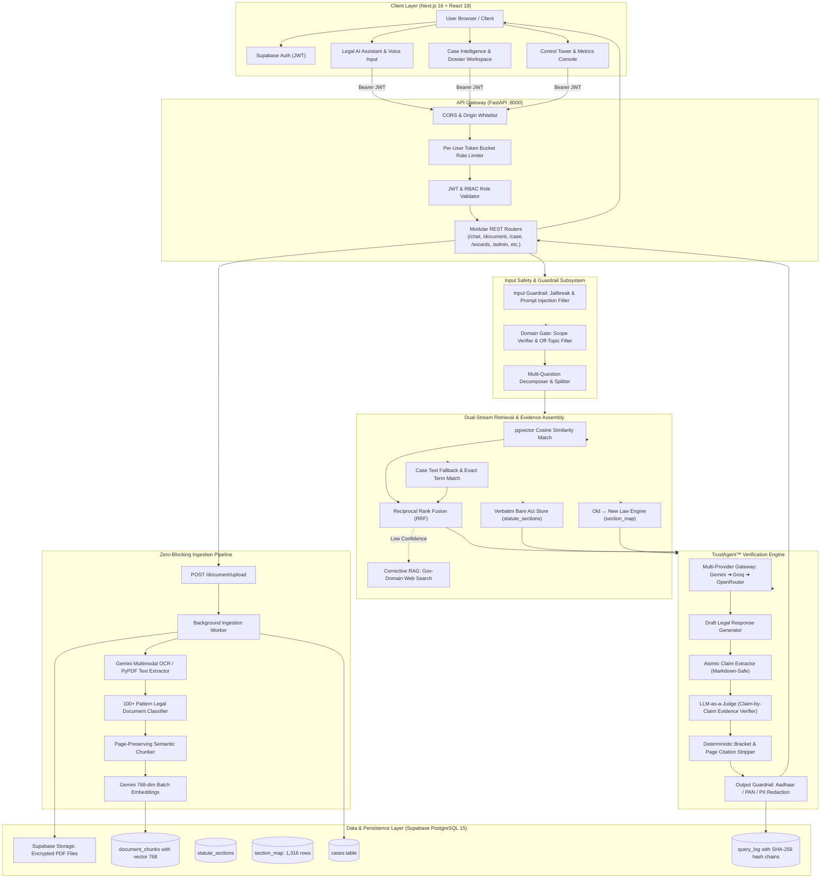
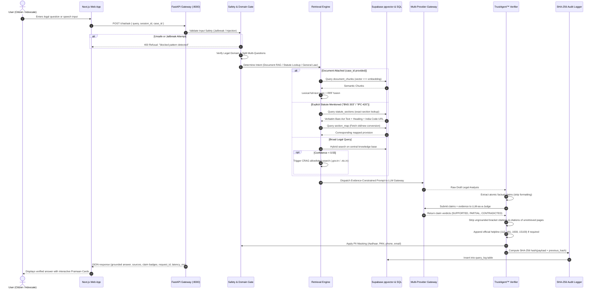
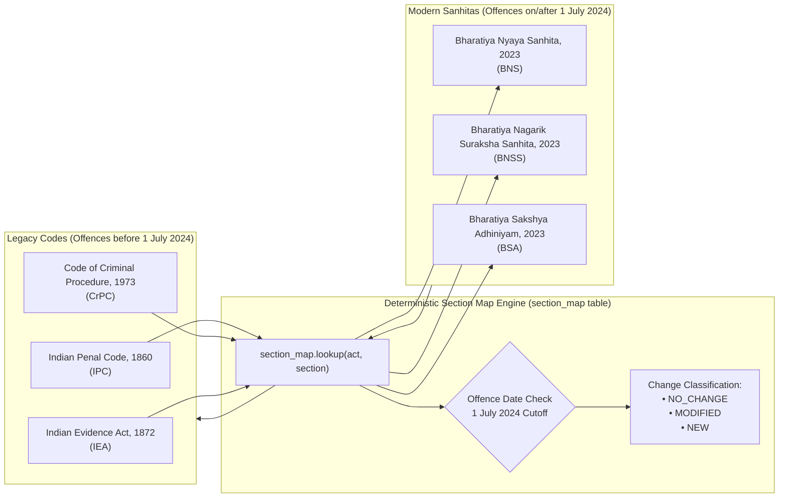
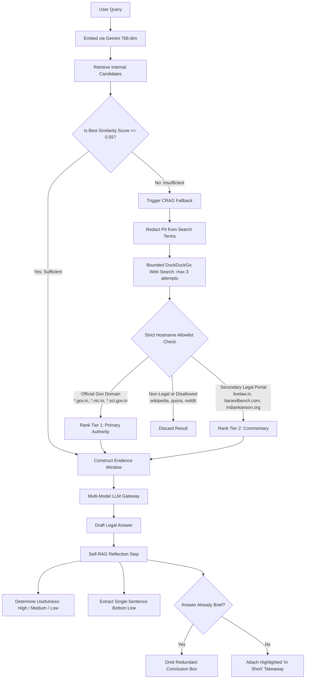
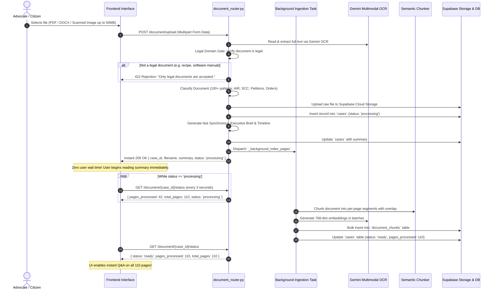
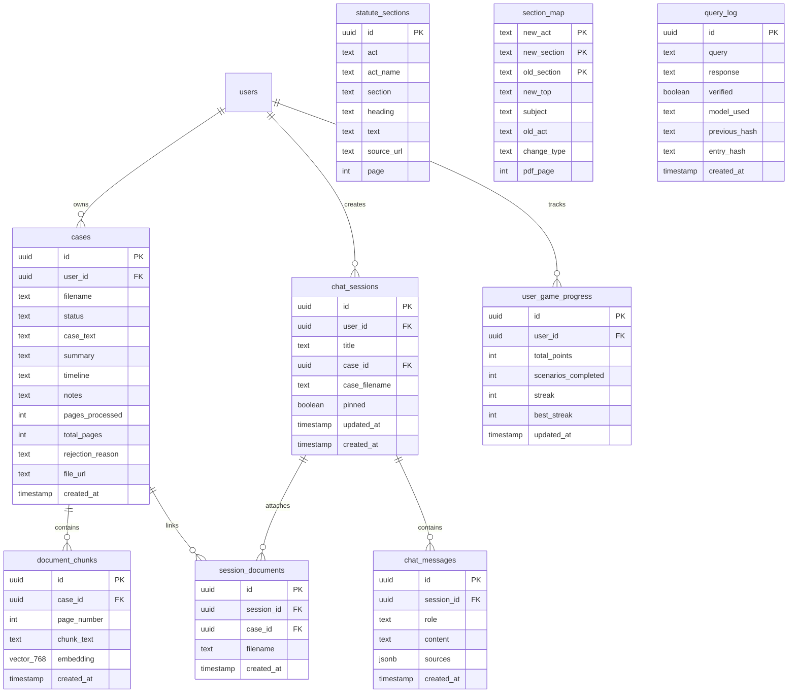
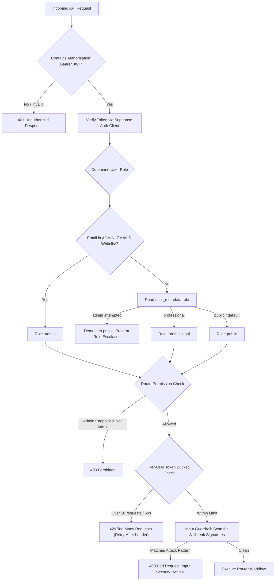
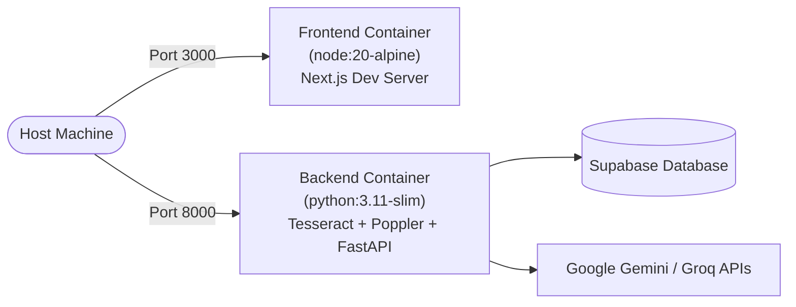
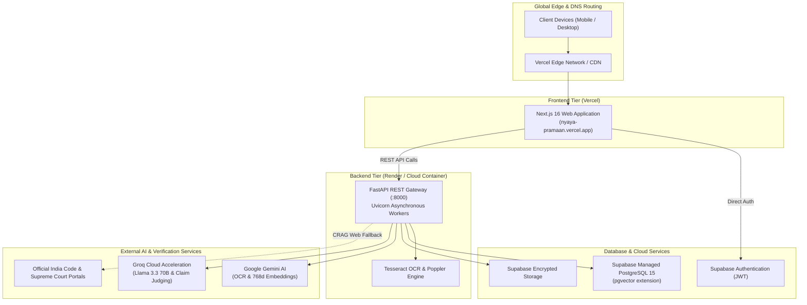

# ⚖️ NyayaPramaan (न्यायप्रमाण)

> **Enterprise Verifiable, Citational, and Transparent AI Platform for the Indian Legal System**  
> *Architected to eliminate hallucinations in statutory interpretation, case analysis, and citizen rights navigation through deterministic grounding, multi-stage verification, and cryptographic auditability.*

[](https://github.com/tanisha-64/NyayaPramaan)
[-black?style=flat&logo=next.js)](https://nextjs.org/)
[](https://react.dev/)
[](https://tailwindcss.com/)
[](https://fastapi.tiangolo.com/)
[](https://www.python.org/)
[](https://www.typescriptlang.org/)
[](https://supabase.com/)
[-4285F4?style=flat&logo=google)](https://ai.google.dev/)
[](https://groq.com/)
[](https://www.docker.com/)
[](https://github.com/tanisha-64/NyayaPramaan/actions)
[](https://opensource.org/licenses/MIT)

---

## 📑 Table of Contents

- [1. Project Overview](#1-project-overview)
- [2. Problem Statement](#2-problem-statement)
- [3. Objectives](#3-objectives)
- [4. Key Highlights](#4-key-highlights)
- [5. User Roles and Workspaces](#5-user-roles-and-workspaces)
- [6. High-Level System Architecture](#6-high-level-system-architecture)
- [7. Complete End-to-End Workflow](#7-complete-end-to-end-workflow)
- [8. AI/ML, RAG, and Conversion Architecture](#8-aiml-rag-and-conversion-architecture)
  - [8.1 Multi-Tier LLM Gateway & Circuit Breaker](#81-multi-tier-llm-gateway--circuit-breaker)
  - [8.2 Section Mapping Engine (Old Law ↔ New Law)](#82-section-mapping-engine-old-law--new-law)
  - [8.3 Corrective RAG (CRAG) & Self-RAG](#83-corrective-rag-crag--self-rag)
- [9. TrustAgent™ Verification Workflow](#9-trustagent-verification-workflow)
- [10. Document Ingestion & Processing Pipeline](#10-document-ingestion--processing-pipeline)
- [11. Frontend Architecture](#11-frontend-architecture)
- [12. Backend Architecture](#12-backend-architecture)
- [13. Database Schema & Data Management](#13-database-schema--data-management)
- [14. Technology Stack](#14-technology-stack)
- [15. Project Directory Structure](#15-project-directory-structure)
- [16. API Specification & Endpoints](#16-api-specification--endpoints)
- [17. Authentication & Security Guardrails](#17-authentication--security-guardrails)
- [18. Local Installation & Setup](#18-local-installation--setup)
- [19. Environment Variables Specification](#19-environment-variables-specification)
- [20. Running the Application](#20-running-the-application)
- [21. Docker Container Orchestration](#21-docker-container-orchestration)
- [22. Deployment Architecture](#22-deployment-architecture)
- [23. Automated Testing & Evaluation Suite](#23-automated-testing--evaluation-suite)
- [24. Current Implementation Status](#24-current-implementation-status)
- [25. Known Limitations](#25-known-limitations)
- [26. Future Scope](#26-future-scope)
- [27. Contributing](#27-contributing)
- [28. License & Disclaimers](#28-license--disclaimers)
- [29. Acknowledgements](#29-acknowledgements)
- [30. Authors & Contact](#30-authors--contact)

---

## 1. Project Overview

**NyayaPramaan (न्यायप्रमाण)** is a production-grade, citation-backed legal intelligence platform engineered specifically for the Indian jurisprudential ecosystem. The name derives from Sanskrit: *Nyaya* (Justice / Legal Reasoning) and *Pramaan* (Cognitive Proof / Evidentiary Grounds). 

Unlike generic probabilistic large language models that generate plausible-sounding but completely fictitious sections and judgments, NyayaPramaan operates under a **strictly zero-hallucination paradigm**:
- Statements of law must resolve to verbatim gazette statutory records or official judicial rulings.
- Generated claims are deconstructed into atomic factual units and verified against retrieved evidence before presentation.
- If verified authority cannot be retrieved, the system explicitly refuses to guess and refers the user to official government sources and emergency helplines.

The platform natively bridges the historic transition of India's criminal justice system implemented on **1 July 2024**, supporting dual-statute lookups across:
- **Bharatiya Nyaya Sanhita (BNS), 2023** ↔ **Indian Penal Code (IPC), 1860**
- **Bharatiya Nagarik Suraksha Sanhita (BNSS), 2023** ↔ **Code of Criminal Procedure (CrPC), 1973**
- **Bharatiya Sakshya Adhiniyam (BSA), 2023** ↔ **Indian Evidence Act (IEA), 1872**
- **Code of Civil Procedure (CPC), 1908**, **Constitution of India**, **Negotiable Instruments Act, 1881**, and specialized central statutes.

---

## 2. Problem Statement

Deploying Large Language Models in legal operations exposes severe, systemic vulnerabilities:

1. **Hallucination of Legal Provisions**: Generic LLMs routinely fabricate section numbers, compound non-existent subsections, and hallucinate Supreme Court case citations. In legal drafting, submitting a fake citation constitutes contempt of court and malpractice.
2. **The 1 July 2024 Statutory Transition**: India replaced its colonial-era criminal codes with modern enactments. LLMs trained on legacy pre-2024 data conflate IPC with BNS sections, failing to recognize that offences committed prior to 1 July 2024 remain governed by the IPC, while subsequent offences are governed by the BNS.
3. **Information Asymmetry for Citizens**: Everyday citizens face complex procedures for FIR filings, bail applications, and cheque dishonour notices, often subjected to police refusal or exploitation due to lack of immediate, understandable statutory knowledge.
4. **Heavy Document Processing Bottlenecks**: Indian court filings, petitions, and landmark rulings frequently span 100 to 300+ pages of scanned or degraded text. Standard RAG architectures choke on token budgets, stall user interfaces, or discard critical evidentiary pages.
5. **Absence of Verifiable Auditability**: In enterprise and compliance environments, legal AI advice lacks an immutable audit trail, making it impossible to prove whether an AI recommendation was grounded in verified law at the time of query.

---

## 3. Objectives

- **Absolute Grounding**: Guarantee that statutory citations, limitation periods, penalty amounts, and case laws delivered to users originate from verified source documents.
- **Bi-Directional Statutory Conversion**: Provide deterministic cross-referencing between old Indian enactments (IPC/CrPC/IEA) and new enactments (BNS/BNSS/BSA) with automatic cut-off date enforcement.
- **Democratized Legal Rights**: Empower citizens with plain-language, bilingual (English & Romanized Hinglish) conversational legal guidance, interactive procedural wizards, and voice-assisted workflows.
- **Advocate & Researcher Acceleration**: Equip legal professionals with rapid case file ingestion, automated case brief generation, visual chronological timeline extraction, and hybrid precedent discovery.
- **Cryptographic Transparency**: Log every legal inquiry, retrieved passage, model generation, and TrustAgent verification verdict into an immutable SHA-256 hash-chained ledger.

---

## 4. Key Highlights

| Pillar | Technical Implementation | Operational Impact |
| :--- | :--- | :--- |
| **Zero-Wait Ingestion** | Async FastAPI background worker with instant 200 OK & real-time polling | 150+ page case records upload instantly without HTTP connection timeouts. |
| **TrustAgent™ Engine** | Atomic claim extractor, independent LLM judge, and bracket citation stripper | Eradicates unbacked claims; delivers colour-coded verification badges per claim. |
| **Statute Mapping** | 1,316 mapped entries across BNS, BNSS, BSA, IPC, CrPC, and IEA (`data/section_map.csv`) | Instant conversion with change-type classification (`MODIFIED`, `NEW`, `NO_CHANGE`). |
| **Multi-Provider Fallback** | 3-tier circuit-breaker gateway: Google Gemini ➔ Groq Llama ➔ OpenRouter | Zero downtime; seamless transition if any upstream LLM provider hits rate limits. |
| **Corrective RAG (CRAG)** | Hostname-strict domain allowlisting (`ddgs`) with PII pre-redaction | When internal retrieval is low-confidence, retrieves exclusively from official `.gov.in`/`.nic.in` sources. |
| **SHA-256 Audit Trail** | Cryptographic hash chaining in Supabase (`query_log` table) | Tamper-evident, compliance-ready proof of retrieval integrity. |
| **Indian PII Shield** | Automated regex masking of Aadhaar, PAN, phone numbers, and emails | Protects sensitive client and litigant personal data before cloud processing. |

---

## 5. User Roles and Workspaces

NyayaPramaan features strict Role-Based Access Control (RBAC) enforced at both the API layer (`backend/auth/supabase_auth.py`) and Next.js UI layer (`frontend/components/auth/RoleGuard.tsx`):

```
                                  ┌────────────────────────┐
                                  │   Supabase User Auth   │
                                  └───────────┬────────────┘
                                              │
                    ┌─────────────────────────┼─────────────────────────┐
                    ▼                         ▼                         ▼
          ┌───────────────────┐     ┌───────────────────┐     ┌───────────────────┐
          │  Public Citizen   │     │ Legal Advocate /  │     │   Super Admin     │
          │     (`public`)    │     │   Professional    │     │   (`admin`)       │
          └─────────┬─────────┘     │  (`professional`) │     └─────────┬─────────┘
                    │               └─────────┬─────────┘               │
                    │                         │                         │
  • Bilingual Research Chat (/public/chat)    │       • Control Tower Console (/admin)
  • Voice Input & Output Assistance           │       • System Health Checks (DB & LLMs)
  • 4 Guided Procedure Wizards (FIR/Bail)     │       • Real-time IST User Analytics
  • Rights-Rakshak Scenario Game (/game)      │       • Citation Accuracy Ratio Monitoring
  • Daily Legal Quiz & Live News Radar        │       • Universal Data Audit Inspection
                    │                         │
                    └────────────┬────────────┘
                                 │
              • Ingest Case Dossiers (/app/dashboard)
              • Executive Case Briefs (Ratio Decidendi)
              • Chronological Legal Timeline
              • Multi-Document Similarity Search
              • Precedent Filtering by Court & Year
```

### Detailed RBAC Feature Matrix

| Feature / Workspace | Public Citizen (`public`) | Legal Professional (`professional`) | Super Admin (`admin`) |
| :--- | :---: | :---: | :---: |
| **Conversational Legal AI & Voice** | ✅ Full Access | ✅ Full Access | ✅ Full Access |
| **Multi-Question Decomposition** | ✅ Supported | ✅ Supported | ✅ Supported |
| **Official Statute Lookup (BNS/IPC)** | ✅ Supported | ✅ Supported | ✅ Supported |
| **Client Case Dossier Ingestion** | ❌ (Session-only upload) | ✅ Persistent Database Workspaces | ✅ Full Administrative Access |
| **Executive Case Brief Generator** | ❌ | ✅ Structured Markdown Dossier | ✅ Full Administrative Access |
| **Chronological Timeline Extractor** | ❌ | ✅ Visual Date-Event Timeline | ✅ Full Administrative Access |
| **Court Precedent Search (SC & HC)** | ❌ | ✅ Full Filter by Court/Year | ✅ Full Administrative Access |
| **Procedure Wizards & Deadline Math** | ✅ Full Access | ✅ Full Access | ✅ Full Access |
| **Rights-Rakshak Scenario Game** | ✅ Gamified with Streaks | ✅ Full Access | ✅ Full Access |
| **Daily Quiz & Legal News Radar** | ✅ Full Access | ✅ Full Access | ✅ Full Access |
| **PDF Chat Export with Devanagari** | ✅ Full Access | ✅ Full Access | ✅ Full Access |
| **Admin Metrics & Health Operations**| ❌ Blocked (403) | ❌ Blocked (403) | ✅ Exclusive Operations Console |
| **Cryptographic SHA-256 Verification**| ✅ Read & Verify | ✅ Read & Verify | ✅ Full Audit Access |

---

## 6. High-Level System Architecture



---

## 7. Complete End-to-End Workflow



---

## 8. AI/ML, RAG, and Conversion Architecture

### 8.1 Multi-Tier LLM Gateway & Circuit Breaker

The LLM abstraction in `ai_core/llm_gateway.py` integrates a resilient fallback chain powered by `litellm`:

```
               ┌────────────────────────────────────────────────────────┐
               │              LLM Request Invocation                    │
               └──────────────────────────┬─────────────────────────────┘
                                          │
                                          ▼
                      ┌───────────────────────────────────────┐
                      │ Check In-Memory SHA-256 LRU Cache    │
                      │ (Max 256 responses, thread-safe)      │
                      └───────┬───────────────────────┬───────┘
                     Hit      │                       │  Miss
             ┌────────────────┘                       └────────────────┐
             ▼                                                         ▼
    Return Cached Response                         ┌───────────────────────────────────────┐
                                                   │ Check Provider Circuit Breakers       │
                                                   │ (cooldown threshold: 60 seconds)      │
                                                   └───────────────────┬───────────────────┘
                                                                       │
                         ┌─────────────────────────────────────────────┼─────────────────────────────────────────────┐
                         ▼                                             ▼                                             ▼
             ┌─────────────────────────┐                   ┌─────────────────────────┐                   ┌─────────────────────────┐
             │ Tier 1: Google Gemini   │                   │ Tier 2: Groq Cloud      │                   │ Tier 3: OpenRouter      │
             │ (gemini-3.6/2.5-flash)  │                   │ (Llama 3.3 70B / OSS)   │                   │ (DeepSeek R1 / Backup)  │
             └───────────┬─────────────┘                   └───────────┬─────────────┘                   └───────────┬─────────────┘
                         │                                             │                                             │
                   Active│ Fails                                 Active│ Fails                                 Active│ Fails
                         ▼                                             ▼                                             ▼
                 Return Generation                             Return Generation                             Return Generation
                         │                                             │                                             │
                         │                                             │                                             ▼
                         │                                             │                                   Graceful Refusal Message:
                         │                                             │                                   "AI service is busy right
                         │                                             │                                   now. Try in a few seconds."
                         └─────────────────────────────────────────────┴─────────────────────────────────────────────┘
```

- **In-Memory Response Caching**: Prompts and models are hashed into SHA-256 keys. Identical queries within the same session or context return in under 5 milliseconds.
- **Circuit Breaker Mechanics**: If an API provider triggers an authentication error, rate limit (HTTP 429), or timeout, the gateway disables that provider for 60 seconds (`BREAKER_SECS = 60`), directing all immediate traffic to the subsequent tier without latency penalties.

### 8.2 Section Mapping Engine (Old Law ↔ New Law)

The conversion system (`ai_core/rag/section_map.py`) is grounded in a database table populated by `data/section_map.csv` containing **1,316 verified legal transitions**:



When a user inquires about an old section (e.g. *"What is Section 302 IPC?"*), the system returns:
1. The historical IPC provision and its applicability to offences prior to 1 July 2024.
2. The exact BNS equivalent (**Section 103 BNS**) with substantive changes noted.
3. Official Indiacode source link and penalty parameters.

### 8.3 Corrective RAG (CRAG) & Self-RAG



---

## 9. TrustAgent™ Verification Workflow

The TrustAgent system (`ai_core/trustagent/`) sits between the generative LLM and the user, functioning as an automated legal verification judge:

```mermaid
flowchart TD
    Raw[Draft Legal Answer from LLM] --> StripMD[Strip Markdown Tables, Pipes & Code Formatting]
    StripMD --> ClaimExtractor[Atomic Claim Extractor: Isolate 3-6 Factual Propositions]
    
    ClaimExtractor --> LLMJudge[LLM-as-a-Judge: gemini-3.6-flash]
    RetrievedEvidence[Retrieved Verbatim Statutory / Case Evidence] --> LLMJudge
    
    subgraph ClaimEvaluation["Claim-Level Grounding Assessment"]
        LLMJudge --> V1{"Verdict for Claim N"}
        V1 -->|Substantiated by passage| S1["SUPPORTED"]
        V1 -->|Core supported, details unstated| S2["PARTIALLY_SUPPORTED"]
        V1 -->|Directly conflicts with source| S3["CONTRADICTED"]
        V1 -->|Not found in evidence| S4["NOT_VERIFIABLE"]
    end
    
    subgraph OverallState["Overall Document Grounding State"]
        S1 & S2 & S3 & S4 --> StateEngine{Aggregate Verdicts}
        StateEngine -->|All claims supported| G["GROUNDED (verified)"]
        StateEngine -->|Some claims supported| PG["PARTIALLY_GROUNDED (partial)"]
        StateEngine -->|All claims contradicted| C["CONTRADICTED (contradicted)"]
        StateEngine -->|Zero evidence matched| NE["NO_EVIDENCE_FOUND (unverified)"]
        StateEngine -->|API/Parser error| VP["VERIFICATION_PENDING (pending)"]
    end
    
    OverallState --> DeterministicChk[Deterministic Citation Checker]
    DeterministicChk --> BracketStripper[Remove [Page X] tags if Page X not in retrieved set]
    DeterministicChk --> SpecificsAudit[Audit ungrounded dates, amounts, section numbers]
    
    DeterministicChk --> FilterAction{Overall Verdict Handling}
    FilterAction -->|GROUNDED| DeliverFull[Deliver Answer with Verified Citations]
    FilterAction -->|PARTIALLY_GROUNDED| FilterClaims[Filter Answer: Keep Supported Claims, Drop Unverified Claims]
    FilterAction -->|CONTRADICTED| RewriteContradiction[Rewrite: Explicitly Note Contradiction with Official Source]
    FilterAction -->|NO_EVIDENCE_FOUND| SafeRefusal["State: No verified source found. Advise India Code or Lawyer."]
    
    DeliverFull & FilterClaims & RewriteContradiction & SafeRefusal --> Helplines[Append Official Helplines: 112, 181, 1930, 15100]
    Helplines --> RedactOut[Redact Aadhaar / PAN / Phone PII]
    RedactOut --> FinalClient[Deliver Structured Response to User]
```

### TrustAgent Verdict Contract

| Verification Status | Badge UI | Meaning | System Behaviour |
| :--- | :---: | :--- | :--- |
| `verified` (`GROUNDED`) | `✅ Verified Against Source` | 100% of factual propositions match verbatim statutory or judicial evidence. | Delivered in full with page citations and links. |
| `partial` (`PARTIALLY_GROUNDED`) | `🟡 Partially Supported` | Core legal premise is accurate, but peripheral details could not be matched. | Answer is filtered to retain confirmed assertions; unconfirmed details dropped. |
| `contradicted` (`CONTRADICTED`) | `🔴 Contradicted by Source` | The AI generation directly asserts facts disproven by the official statute. | Answer rewritten to eliminate contradiction; alerts user to conflicting rule. |
| `unverified` (`NO_EVIDENCE_FOUND`) | `⚪ Unverified / No Evidence` | No corresponding bare act or precedent exists in the repository. | AI memory answers suppressed; standard refusal message with helpline links emitted. |
| `pending` (`VERIFICATION_PENDING`) | `⏳ Verification Pending` | Background verification was interrupted or infrastructure timed out. | Message delivered with clear disclaimer that grounding check is incomplete. |

---

## 10. Document Ingestion & Processing Pipeline



---

## 11. Frontend Architecture

The frontend is built on **Next.js 16 (App Router)** and **React 19**, styled using **Tailwind CSS v4** with custom legal design tokens.

### Page Directory Map

```
frontend/app/
├── layout.tsx                     # Global Root Layout, Theme Providers & Fonts
├── page.tsx                       # Landing Page: Hero, Interactive Pipeline, Comparison
├── globals.css                    # Tailwind CSS v4 directives & custom animations
├── login/page.tsx                 # Supabase Authentication Sign-In
├── register/page.tsx              # Account Registration with Role Selection
├── how-it-works/page.tsx          # Educational Walkthrough of Verification Flow
├── trust-verification/page.tsx    # Live Trust & Verification Architecture Viewer
├── game/page.tsx                  # Rights-Rakshak Scenario-Based Learning Game
├── quiz/page.tsx                  # Daily Legal Quiz with Streaks & Explanations
├── news/page.tsx                  # Live Indian Legal & Constitutional News Radar
├── admin/page.tsx                 # Superadmin Control Tower & Health Monitoring
├── public/
│   ├── chat/page.tsx              # Bilingual Legal Research Assistant with Voice & Uploads
│   └── saved/page.tsx             # Saved Answers & Citations Bookmarks Manager
└── app/
    └── dashboard/page.tsx         # Professional Precedent & Client Case Workspace
```

### Key Frontend Components & Services

- **`AnswerCard.tsx`**: Renders verified answers, expandable source tabs, verdict badges, department recommendations, and bottom-line conclusion callouts.
- **`WizardModal.tsx`**: Interactive, tree-walking modal delivering step-by-step guidance for FIR refusals, bail options, scam detection, and cheque bounce calculations.
- **`ChatSidebar.tsx`**: Session manager supporting new chats, conversation renaming, session pinning, and history retrieval.
- **`useVoiceInput.ts`**: Speech-to-Text hook using the browser Web Speech API with automatic language recognition for English and Hindi.
- **`useVoiceOutput.ts`**: Text-to-Speech synthesizer reading verified answers aloud with rate and pitch controls.
- **`apiClient.ts`**: Centralized HTTP client managing Supabase JWT attachment, automatic port failover between `127.0.0.1` and `localhost`, and structured error parsing.

---

## 12. Backend Architecture

The backend is built with **FastAPI** (Python 3.11+), organized into modular, decoupled service layers:

```
backend/
├── main.py                        # Application entrypoint, CORS, and router registration
├── auth/
│   └── supabase_auth.py           # JWT token validation, role resolution, admin whitelisting
├── db/
│   └── supabase_storage.py        # Supabase S3-compatible cloud storage operations
├── eval/
│   ├── run_eval.py                # Local evaluation runner: accuracy, retrieval & faithfulness
│   └── test_cases.json            # Regression test suite test cases
├── routers/
│   ├── chat_router.py             # Chat sessions, multi-question QA, PDF export, RAG retrieval
│   ├── document_router.py         # File uploads, background indexing worker, status polling
│   ├── case_router.py             # Case dossier CRUD, executive brief, notes & timeline
│   ├── wizard_router.py           # Guided procedure trees & NI Act Section 138 deadline math
│   ├── search_router.py           # Precedent candidate search filtered by court, year, jurisdiction
│   ├── admin_router.py            # Operations metrics, IST active users, DB/LLM health ping
│   ├── quiz_router.py             # Daily legal quiz caching and generation
│   ├── news_router.py             # Google News RSS aggregation with legal topic-based images
│   ├── game_router.py             # Rights-Rakshak scenario generator, streaks, and scoring
│   └── tools_router.py            # Cheque deadline calculator & platform scope information
└── wizards/
    └── wizard_definitions.py      # Declarative procedural trees and checklists
```

---

## 13. Database Schema & Data Management

NyayaPramaan relies on **PostgreSQL 15+** managed via **Supabase**, enhanced with the **`pgvector`** extension:



### Essential Database RPC Functions

The database uses PostgreSQL stored procedures for cosine distance matching:

- **`match_document_chunks(query_embedding, target_case_id, match_count)`**: Computes `1 - (embedding <=> query_embedding)` over chunks belonging to a single case.
- **`match_document_chunks_multi(query_embedding, target_case_ids, match_count)`**: Extends similarity matching across multiple dossiers simultaneously.
- **`hybrid_search_judgments(query_embedding, query_text, match_count)`**: Blends vector proximity with full-text keyword ranking on landmark cases.
- **`hybrid_search_statutes(query_embedding, query_text, match_count)`**: Combines vector proximity with section-number boosting on statutory provisions.

---

## 14. Technology Stack

### Frontend Technologies

| Technology | Purpose | Where Used | Why Selected |
| :--- | :--- | :--- | :--- |
| **Next.js 16.3.3** | Web Application Framework | Entire `frontend/` directory | Modern React Server Components, App Router, high performance, and rapid client navigation. |
| **React 19.2.8** | UI Library | All components in `frontend/components/` | Latest React primitives, concurrent rendering, and clean hook architecture. |
| **Tailwind CSS v4** | Utility-First CSS | `frontend/app/globals.css` | High-performance compiled styles without runtime CSS overhead. |
| **TypeScript 5.0** | Type Safety | All `.ts` and `.tsx` source files | Enforces rigid contracts across API requests, responses, and UI component props. |
| **Lucide React** | Iconography | Navigation, cards, and modal components | Clean, lightweight, consistent icon set with minimal bundle footprint. |
| **Web Speech API** | Voice Input & Output | `useVoiceInput.ts`, `useVoiceOutput.ts` | Zero-dependency native browser STT and TTS without requiring third-party audio API keys. |

### Backend Technologies

| Technology | Purpose | Where Used | Why Selected |
| :--- | :--- | :--- | :--- |
| **FastAPI** | REST API Framework | `backend/main.py` and routers | Async request handling, automatic OpenAPI/Swagger documentation, and Pydantic validation. |
| **Uvicorn** | ASGI Web Server | Server execution runtime | High-throughput asynchronous HTTP processing for Python. |
| **Pydantic v2** | Data Serialization & Validation | Request/Response models in all routers | Robust runtime data validation and high-speed JSON serialization. |
| **fpdf2** | PDF Generation | Chat PDF export in `backend/routers/chat_router.py` | Lightweight pure-Python PDF rendering with support for native Devanagari TTF fonts. |
| **python-dotenv** | Environment Configuration | App entrypoint and utility modules | Seamless local `.env` loading conforming to Twelve-Factor App principles. |

### AI / ML & RAG Engine

| Technology | Purpose | Where Used | Why Selected |
| :--- | :--- | :--- | :--- |
| **google-genai** | Multimodal OCR & Embeddings | `ai_core/rag/embeddings.py`, `document_reader.py` | Official SDK for `gemini-embedding-001` (768 dimensions) and full-text document vision OCR. |
| **LiteLLM** | Universal LLM Proxy | `ai_core/llm_gateway.py` | Standardized interface across Google Gemini, Groq, and OpenRouter with timeout management. |
| **Groq SDK** | Ultra-Fast Inference | `ai_core/llm_gateway.py`, `ai_core/evaluation/llm_judge.py` | Low-latency inference (Llama 3.3 70B / GPT-OSS) for atomic claim extraction and judging. |
| **ddgs (DuckDuckGo)** | Privacy-Preserving Web Search | `ai_core/rag/crag_corrector.py` | Headless, zero-API-key search for authoritative Indian legal portals during CRAG failover. |
| **PyPDF / pdf2image** | Local PDF Parsing | `ai_core/rag/document_chunker.py` | Fast local extraction of structured digital PDFs prior to OCR fallback. |
| **pytesseract** | Fallback OCR | `backend/Dockerfile` | Local open-source OCR fallback for degraded documents when external APIs are unreachable. |

### Database, Storage & Infrastructure

| Technology | Purpose | Where Used | Why Selected |
| :--- | :--- | :--- | :--- |
| **Supabase (PostgreSQL 15)** | Managed Relational DB | Primary application database | Enterprise relational storage with native Row-Level Security and Auth integration. |
| **pgvector** | Vector Similarity Extension | `document_chunks`, `judgments`, `statute_sections` | High-performance in-database cosine and L2 distance indexing (`vector(768)`). |
| **Supabase Storage** | Object Storage | Encrypted PDF repository | S3-compatible, secure storage for raw client case files and evidence dossiers. |
| **Docker & Docker Compose** | Container Orchestration | `backend/Dockerfile`, `docker-compose.yml` | Uniform multi-service execution across development, staging, and production environments. |

---

## 15. Project Directory Structure

```plaintext
NyayaPramaan/
├── .github/
│   └── workflows/
│       └── ci.yml                     # GitHub Actions CI: backend pytest & frontend build
├── ai_core/                           # Core AI Intelligence, RAG, & Verification Engine
│   ├── evaluation/                    # Verification Judges, News, & Games
│   │   ├── llm_judge.py               # LLM-as-a-Judge claim-by-claim evidence verifier
│   │   ├── news_fetcher.py            # Live legal news aggregator via Google News RSS
│   │   ├── quiz_generator.py          # Daily constitutional and statutory quiz generator
│   │   └── rights_game_generator.py   # Rights-Rakshak scenario generator & score keeper
│   ├── formatting/                    # Post-generation Grounding & Answer Styling
│   │   ├── answer_style.py            # Style guide enforcement for plain-language responses
│   │   └── grounding.py               # Deterministic entity stripper for unbacked facts
│   ├── guardrails/                    # Input and Output Security Filters
│   │   ├── input_guard.py             # Jailbreak, prompt-injection, and override detector
│   │   └── output_guard.py            # PII redactor (Aadhaar, PAN, phone, email)
│   ├── rag/                           # Retrieval-Augmented Generation Subsystem
│   │   ├── case_text_fallback.py      # Direct case_text lexical scan for small/failed chunks
│   │   ├── cheque_deadlines.py        # NI Act Section 138 deadline calculation logic
│   │   ├── crag_corrector.py          # Corrective RAG: allowlisted .gov.in search
│   │   ├── document_chunker.py        # Page-preserving text chunker & pgvector indexer
│   │   ├── document_classifier.py     # 100+ pattern Indian legal document classifier
│   │   ├── document_reader.py         # Full-document extraction with Gemini OCR fallback
│   │   ├── embeddings.py              # Google Gemini 768-dim single and batch embedder
│   │   ├── legal_scope.py             # Permitted legal domain verifier & off-topic router
│   │   ├── section_map.py             # Old Law (IPC/CrPC/IEA) ↔ New Law (BNS/BNSS/BSA)
│   │   ├── self_rag.py                # Self-critique, usefulness evaluation, and bottom-line
│   │   ├── statutes.py                # Bare Act verbatim lookup and heading search
│   │   ├── summarizer.py              # Windowed case summarizer (head + tail)
│   │   └── vector_store.py            # Supabase pgvector client and hybrid search RPCs
│   ├── router/                        # Query Routing & Language Intent Detection
│   │   ├── adaptive_router.py         # Task-to-model dispatcher
│   │   ├── domain_gate.py             # Legal scope classification & greeting handlers
│   │   ├── intent_classifier.py       # Audience classifier (citizen vs legal professional)
│   │   └── multi_question.py          # Multi-part question decomposer & answer merger
│   ├── timeline/
│   │   └── extractor.py               # Chronological date-and-event extraction engine
│   ├── trustagent/                    # TrustAgent™ Grounding Verification Pipeline
│   │   ├── citations.py               # Deterministic citation validator & bracket stripper
│   │   ├── claim_extractor.py         # Markdown-safe atomic claim deconstruction
│   │   └── corrector.py               # Answer re-writer, helpline & department recommender
│   └── llm_gateway.py                 # 3-tier fallback LLM gateway with circuit breaker
├── backend/                           # FastAPI Application Gateway & Handlers
│   ├── auth/
│   │   └── supabase_auth.py           # Supabase JWT validator & role-based access control
│   ├── db/
│   │   └── supabase_storage.py        # File upload and download helpers for Supabase Storage
│   ├── eval/                          # Local Evaluation Suite
│   │   ├── run_eval.py                # CLI runner checking citation accuracy & faithfulness
│   │   └── test_cases.json            # Ground-truth test dataset
│   ├── routers/                       # REST Endpoint Handlers
│   │   ├── admin_router.py            # Control Tower metrics, health ping, active users
│   │   ├── case_router.py             # Case dossier management, briefs, timeline, notes
│   │   ├── chat_router.py             # Primary Q&A, sessions, PDF export, multi-question
│   │   ├── document_router.py         # Document upload, background worker, status polling
│   │   ├── game_router.py             # Rights-Rakshak scenario delivery & user streaks
│   │   ├── news_router.py             # Live legal news feed with topic-based images
│   │   ├── quiz_router.py             # Daily legal quiz retrieval & caching
│   │   ├── search_router.py           # Precedent candidate search (court/year filters)
│   │   ├── tools_router.py            # Cheque bounce calculator & platform scope info
│   │   └── wizard_router.py           # Step-by-step procedural guides & deadline tools
│   ├── wizards/
│   │   └── wizard_definitions.py      # Declarative procedural trees (FIR, bail, scam)
│   ├── Dockerfile                     # Backend container specification
│   └── main.py                        # FastAPI application setup, CORS, and routing
├── data/
│   └── section_map.csv                # 1,316 rows mapping IPC/CrPC/IEA to BNS/BNSS/BSA
├── docs/                              # Project Documentation & Architecture Guides
│   ├── implementation_plan.md         # Comprehensive implementation specifications
│   └── walkthrough.md                 # End-to-end testing and operations guide
├── frontend/                          # Next.js 16 Web Application
│   ├── app/                           # App Router pages and routes
│   ├── components/                    # Reusable React components (Chat, Auth, Layout)
│   ├── hooks/                         # React hooks (useAuth, useVoiceInput, useVoiceOutput)
│   ├── lib/                           # Third-party client initializers (supabaseClient)
│   ├── services/                      # API service clients (chat, document, admin, game)
│   ├── Dockerfile                     # Frontend container specification
│   ├── package.json                   # Node.js dependencies & scripts
│   ├── postcss.config.mjs             # PostCSS configuration for Tailwind CSS v4
│   └── tsconfig.json                  # TypeScript compiler configuration
├── scripts/                           # Database Ingestion & Benchmark Utilities
│   ├── bench.py                       # Automated latency & citation accuracy benchmarker
│   ├── ingest_statutes.py             # India Code Bare Act PDF ingestor & sanity validator
│   └── load_section_map.py            # Imports data/section_map.csv into Supabase
├── tests/                             # Automated Pytest Regression & Integration Suite
│   └── test_api.py                    # End-to-end API tests (guardrails, CORS, auth, uploads)
├── trust_log/                         # Cryptographic Hash-Chain Ledger System
│   └── hash_chain.py                  # SHA-256 block constructor and chain validator
├── .env.example                       # Reference environment variables template
├── .gitignore                         # Version control exclusions
├── docker-compose.yml                 # Multi-container orchestration (backend + frontend)
├── pytest.ini                         # Pytest configuration settings
├── requirements.txt                   # Backend Python dependencies
├── supabase_schema_updates.sql        # Database migrations, tables, and RPC functions
└── README.md                          # Project documentation
```

---

## 16. API Specification & Endpoints

All protected endpoints require the following HTTP header:  
`Authorization: Bearer <supabase-jwt-access-token>`

### 1. Chat & Conversational Assistant (`/chat`)

| Method | Endpoint | Access | Description |
| :--- | :--- | :--- | :--- |
| `POST` | `/chat/ask` | Authenticated | Primary legal Q&A endpoint. Accepts query, optional `case_id`, and `session_id`. Handles multi-question splitting, hybrid retrieval, TrustAgent verification, and PII masking. |
| `GET` | `/chat/sessions` | Authenticated | Retrieves all chat sessions for the authenticated user, sorted by pinned status and updated date. |
| `POST` | `/chat/sessions` | Authenticated | Initializes a new chat session with a custom or default title. |
| `GET` | `/chat/sessions/{id}/messages` | Authenticated | Fetches message history, sources, and linked document metadata for a session. |
| `PATCH` | `/chat/sessions/{id}` | Authenticated | Renames a chat session title or toggles its pinned status. |
| `DELETE` | `/chat/sessions/{id}` | Authenticated | Permanently deletes a chat session and all associated messages. |
| `DELETE` | `/chat/sessions/{id}/messages/from/{msg_id}`| Authenticated | Deletes a message and all subsequent messages to support question editing and re-asking. |
| `GET` | `/chat/debug/case/{case_id}` | Case Owner | Diagnostic probe returning chunk count, text length, and RPC availability for a case. |

### 2. Document Processing & Ingestion (`/document`)

| Method | Endpoint | Access | Description |
| :--- | :--- | :--- | :--- |
| `POST` | `/document/upload` | Authenticated | Accepts multipart legal file (`.pdf`, `.docx`, `.txt`, scanned images). Performs legal gate check, synchronous brief generation, and spawns async indexing. |
| `GET` | `/document/{case_id}/status` | Case Owner | Polls live ingestion progress (`pages_processed`, `total_pages`, `status`: `'processing' \| 'ready' \| 'failed'`). |
| `POST` | `/document/{case_id}/retry-indexing` | Case Owner | Re-triggers chunking and embedding from stored text if a document was interrupted mid-run. |
| `DELETE` | `/document/{case_id}` | Case Owner | Deletes the case file, extracted text, and all associated vector chunks from the database. |

### 3. Case Dossiers & Precedents (`/case`)

| Method | Endpoint | Access | Description |
| :--- | :--- | :--- | :--- |
| `GET` | `/case/list` | Authenticated | Lists all case dossiers belonging to the current user. |
| `GET` | `/case/{case_id}` | Case Owner | Retrieves full case record including raw text, summary, timeline, and user notes. |
| `PUT` | `/case/{case_id}/notes` | Case Owner | Updates persistent practitioner notes associated with the case dossier. |
| `POST` | `/case/{case_id}/regenerate-summary`| Case Owner | Re-runs summarization if the initial summary failed due to LLM provider downtime. |
| `GET` | `/case/{case_id}/brief` | Case Owner | Generates an executive High Court-style Case Brief with Ratio Decidendi and Material Facts. |
| `DELETE` | `/case/{case_id}` | Case Owner | Removes a single case and disassociates related session documents. |
| `DELETE` | `/case/clear/all` | Case Owner | Bulk clears all cases and vector chunks belonging to the current user. |

### 4. Guided Procedure Wizards (`/wizards`)

| Method | Endpoint | Access | Description |
| :--- | :--- | :--- | :--- |
| `GET` | `/wizards/list` | Authenticated | Returns all available procedure wizards (FIR Refusal, Bail, Cheque Bounce, Scam Check). |
| `GET` | `/wizards/{wizard_id}` | Authenticated | Retrieves the complete branching decision tree, options, and checklists for a wizard. |
| `POST` | `/wizards/cheque-bounce/deadline` | Authenticated | Computes statutory limitation dates under Section 138 of the Negotiable Instruments Act. |

### 5. Control Tower & Operations (`/admin`)

| Method | Endpoint | Access | Description |
| :--- | :--- | :--- | :--- |
| `GET` | `/admin/metrics` | Admin Role | Aggregates total queries, TrustAgent verification rates, and multi-model usage distribution. |
| `GET` | `/admin/judgments-count` | Admin Role | Returns total number of indexed landmark judgments in the central knowledge base. |
| `GET` | `/admin/activity` | Admin Role | Returns registered users and active users active today (calculated from midnight IST). |
| `GET` | `/admin/health` | Admin Role | Live health probe testing Supabase DB connection, indexed store, and LLM gateway. |

### 6. Specialized Utilities (`/quiz`, `/news`, `/game`, `/tools`, `/search`)

| Method | Endpoint | Access | Description |
| :--- | :--- | :--- | :--- |
| `GET` | `/quiz/today` | Public / Auth | Fetches today's cached 5-question legal quiz or dynamically generates a new quiz. |
| `GET` | `/news/legal` | Public / Auth | Delivers verified legal news aggregated from Google News RSS with topic-themed images. |
| `GET` | `/game/scenario` | Public / Auth | Returns a legal rights decision-making scenario across constitutional and criminal domains. |
| `POST` | `/game/answer` | Optional User | Submits user choice, updates points, streaks, and personal best scores. |
| `GET` | `/game/progress` | Optional User | Retrieves cumulative score, streak, and tier level for the authenticated user. |
| `POST` | `/tools/cheque-deadlines` | Authenticated | Advanced statutory timeline calculator under Negotiable Instruments Act, 1881. |
| `GET` | `/tools/scope` | Authenticated | Returns platform supported legal domains and suggested starter questions. |
| `POST` | `/search/precedents` | Authenticated | Filters precedents across Supreme Court and High Courts with year and jurisdiction filters. |
| `GET` | `/health` | Public | Unauthenticated baseline health probe returning `{"status": "ok"}`. |

---

## 17. Authentication & Security Guardrails



### Security & Privacy Controls

1. **Anti-Escalation Architecture**: Even if a malicious user alters their Supabase `user_metadata` to claim `{"role": "admin"}`, `backend/auth/supabase_auth.py` strictly verifies that the user's email address is explicitly registered in the environment's `ADMIN_EMAILS` whitelist. Unauthorized attempts are automatically demoted to `public`.
2. **Deterministic PII Redaction**: Before any model response is returned to the user or recorded in the permanent audit ledger, `ai_core/guardrails/output_guard.py` executes regular expression filters:
   - **Aadhaar Numbers**: Masked as `[REDACTED_AADHAAR]` (handles 12-digit grouped formats).
   - **PAN Cards**: Masked as `[REDACTED_PAN]` (handles standard alphanumeric 10-character format).
   - **Phone Numbers**: Masked as `[REDACTED_PHONE]` (handles Indian +91 and 10-digit formats).
   - **Email Addresses**: Masked as `[REDACTED_EMAIL]`.
3. **CORS Hardening**: `backend/main.py` explicitly whitelists trusted domains (`nyaya-pramaan.vercel.app`, `localhost:3000`) and dynamically ingests origins from `FRONTEND_URL` and `ALLOWED_ORIGINS` environment variables, rejecting unauthorized cross-site invocations.

---

## 18. Local Installation & Setup

### Prerequisites

Ensure the following tools are installed on your host system:
- **Python**: Version `3.11.x` or higher ([python.org](https://www.python.org/downloads/))
- **Node.js**: Version `20.x` or higher ([nodejs.org](https://nodejs.org/))
- **npm**: Version `10.x` or higher (bundled with Node.js)
- **Git**: ([git-scm.com](https://git-scm.com/))
- **Supabase Account**: A provisioned PostgreSQL project with `pgvector` enabled ([supabase.com](https://supabase.com/))
- **System Binaries for OCR (Optional for local document OCR)**:
  - *Ubuntu/Debian*: `sudo apt-get install tesseract-ocr poppler-utils`
  - *macOS*: `brew install tesseract poppler`
  - *Windows*: Download installers for [Tesseract at UB-Mannheim](https://github.com/UB-Mannheim/tesseract/wiki) and [Poppler for Windows](https://github.com/oschwartz10612/poppler-windows).

---

### Step-by-Step Installation

#### 1. Clone the Repository

```bash
git clone https://github.com/tanisha-64/NyayaPramaan.git
cd NyayaPramaan
```

#### 2. Backend Setup & Virtual Environment

**Windows (PowerShell):**
```powershell
# Create Python virtual environment
python -m venv venv

# Activate virtual environment
.\venv\Scripts\Activate.ps1

# Upgrade pip and install all backend dependencies
python -m pip install --upgrade pip
pip install -r requirements.txt
```

**Linux / macOS (Bash/Zsh):**
```bash
# Create Python virtual environment
python3 -m venv venv

# Activate virtual environment
source venv/bin/activate

# Upgrade pip and install all backend dependencies
pip install --upgrade pip
pip install -r requirements.txt
```

#### 3. Frontend Setup

```bash
cd frontend
npm install
cd ..
```

#### 4. Database Setup (Supabase)

1. Open your project on the [Supabase Dashboard](https://supabase.com/dashboard).
2. Navigate to **SQL Editor**.
3. Copy and execute the contents of `supabase_schema_updates.sql`.
4. (Optional) Ingest the statutory transition dataset into your Supabase database:
   ```bash
   python scripts/load_section_map.py data/section_map.csv
   ```

---

## 19. Environment Variables Specification

Create a root-level `.env` file based on `.env.example`:

```bash
cp .env.example .env
```

### Complete Environment Variable Reference

| Variable Name | Required | Default / Example Value | Description |
| :--- | :---: | :--- | :--- |
| `SUPABASE_URL` | **Yes** | `https://your-project.supabase.co` | Project URL from Supabase Settings ➔ API |
| `SUPABASE_ANON_KEY` | **Yes** | `eyJhbGciOi...` | Public Anonymous Key for client verification |
| `SUPABASE_SERVICE_ROLE_KEY` | **Yes** | `eyJhbGciOi...` | Service Role Key for backend administrative queries |
| `GEMINI_API_KEY` | **Yes** | `AIzaSy...` | Google AI Studio API key for Gemini OCR & Embeddings |
| `GROQ_API_KEY` | **Yes** | `gsk_...` | Groq API Key for low-latency inference & claim judging |
| `OPENROUTER_API_KEY` | Optional | `sk-or-...` | OpenRouter API Key for third-tier fallback models |
| `GEMINI_MODEL` | Optional | `gemini/gemini-3.6-flash` | LiteLLM model identifier for primary inference |
| `GROQ_MODEL` | Optional | `groq/openai/gpt-oss-20b` | LiteLLM model identifier for secondary inference |
| `ADMIN_EMAILS` | Optional | `mitanisha74@gmail.com` | Comma-separated emails granted `admin` role |
| `FRONTEND_URL` | Optional | `http://localhost:3000` | Allowed origin for FastAPI CORS middleware |
| `NEXT_PUBLIC_API_BASE_URL` | **Yes** | `http://localhost:8000` | Base backend URL consumed by Next.js client |
| `NEXT_PUBLIC_SUPABASE_URL` | **Yes** | `https://your-project.supabase.co` | Supabase URL accessible to browser client |
| `NEXT_PUBLIC_SUPABASE_ANON_KEY` | **Yes** | `eyJhbGciOi...` | Supabase Anonymous Key accessible to browser client |
| `NEXT_PUBLIC_ADMIN_EMAIL` | Optional | `mitanisha74@gmail.com` | Primary admin email displayed in client UI |

---

## 20. Running the Application

### 1. Start Backend API Server

Activate your virtual environment and launch FastAPI with Uvicorn:

**Windows (PowerShell):**
```powershell
.\venv\Scripts\Activate.ps1
uvicorn backend.main:app --host 127.0.0.1 --port 8000 --reload
```

**Linux / macOS:**
```bash
source venv/bin/activate
uvicorn backend.main:app --host 127.0.0.1 --port 8000 --reload
```

- **Interactive API Documentation (Swagger)**: [http://127.0.0.1:8000/docs](http://127.0.0.1:8000/docs)
- **Alternative Documentation (ReDoc)**: [http://127.0.0.1:8000/redoc](http://127.0.0.1:8000/redoc)
- **Health Check Probe**: [http://127.0.0.1:8000/health](http://127.0.0.1:8000/health)

### 2. Start Frontend Web Client

In a separate terminal window:

```bash
cd frontend
npm run dev
```

- **Web Application Portal**: [http://localhost:3000](http://localhost:3000)

---

## 21. Docker Container Orchestration

NyayaPramaan provides multi-container orchestration via `docker-compose.yml`.

### Architecture of Docker Containers



### Running with Docker Compose

1. Ensure Docker Desktop or Docker Engine is running.
2. Ensure your `.env` file is present in the repository root.
3. Build and launch the container cluster:

```bash
docker compose up --build
```

To run in the background (detached mode):
```bash
docker compose up -d
```

To stop all containers:
```bash
docker compose down
```

---

## 22. Deployment Architecture



---

## 23. Automated Testing & Evaluation Suite

### 1. Pytest Unit & Integration Tests

The test suite in `tests/test_api.py` evaluates system integrity without incurring API token costs by mocking external cloud dependencies where appropriate:

```bash
# Run pytest across the entire test suite
python -m pytest tests/ -v
```

#### What the Automated Tests Verify:
- **`test_health_endpoint`**: Confirms baseline HTTP 200 and JSON availability.
- **`test_input_guardrails_safety`**: Confirms jailbreak attempts and system prompt extraction attacks are blocked.
- **`test_output_guardrails_pii_redaction`**: Confirms Aadhaar and phone numbers are completely masked.
- **`test_intent_classification`**: Confirms legal queries route to legal domains and off-topic queries trigger standard refusals.
- **`test_hash_chain_integrity`**: Confirms mathematical SHA-256 continuity of consecutive audit log entries.
- **`test_document_classifier`**: Confirms landmark judgment filenames (`A_K_Gopalan...pdf`), court formats (`AIR`, `SCC`, `SCR`), and case types are recognized.
- **`test_cors_preflight_and_case_list_headers`**: Confirms CORS preflight requests and credentials match production domains.
- **`test_document_upload_and_status_endpoint_success`**: Confirms end-to-end multipart upload and progress status polling.

### 2. Local Faithfulness & Retrieval Evaluation (`backend/eval/`)

NyayaPramaan includes a local legal evaluation harness:

```bash
python -m backend.eval.run_eval
```

This script evaluates three core dimensions against ground-truth benchmarks (`backend/eval/test_cases.json`):
1. **Citation Accuracy**: Evaluates whether retrieved statutory provisions match the expected statute and section.
2. **Retrieval Quality**: Evaluates whether multi-page document queries retrieve the exact target page numbers.
3. **Faithfulness**: Uses an LLM judge to verify that statements in the answer are strictly supported by retrieved evidence without extrapolation.

### 3. Automated Benchmark Script (`scripts/bench.py`)

To evaluate latency and numerical citation accuracy against a live running backend:

**PowerShell:**
```powershell
$env:TOKEN="<your-supabase-jwt-token>"
$env:BASE_URL="http://127.0.0.1:8000"
python scripts/bench.py
```

---

## 24. Current Implementation Status

To maintain transparent, honest technical documentation, the following breakdown distinguishes fully implemented, partially implemented, and planned features:

| Feature / Component | Status | Source Implementation | Notes |
| :--- | :---: | :--- | :--- |
| **Bilingual Legal Assistant** | 🟢 Complete | `backend/routers/chat_router.py` | Full support for English and Romanized Hinglish. |
| **TrustAgent™ Claim Verification** | 🟢 Complete | `ai_core/trustagent/` | Atomic extraction, LLM judge, and citation checks. |
| **Old ↔ New Law Mapping** | 🟢 Complete | `ai_core/rag/section_map.py` | 1,316 mapped entries across BNS, BNSS, BSA, IPC, CrPC, IEA. |
| **Zero-Wait Document Ingestion** | 🟢 Complete | `backend/routers/document_router.py` | Background async processing with live page progress polling. |
| **Input / Output Guardrails** | 🟢 Complete | `ai_core/guardrails/` | Prompt injection detection and regex PII masking. |
| **SHA-256 Audit Ledger** | 🟢 Complete | `trust_log/hash_chain.py` | Cryptographic chained logging in Supabase `query_log`. |
| **Procedure Wizards (4 Flows)** | 🟢 Complete | `backend/wizards/` | FIR refusal, bail, cheque bounce, and scam detection. |
| **Cheque Bounce Deadline Calculator**| 🟢 Complete | `ai_core/rag/cheque_deadlines.py` | Calculates 30-day notice, 15-day cure, and 30-day filing dates. |
| **Rights-Rakshak Scenario Game** | 🟢 Complete | `ai_core/evaluation/rights_game_generator.py` | Gamified rights learning with levels, streaks, and scores. |
| **Daily Quiz & Legal News Radar** | 🟢 Complete | `backend/routers/quiz_router.py`, `news_router.py` | Live RSS news with topic-themed image selection. |
| **PDF Chat Export (Devanagari)** | 🟢 Complete | `backend/routers/chat_router.py` | Pure Python `fpdf2` export with auto-detected Devanagari TTF. |
| **Superadmin Operations Console** | 🟢 Complete | `backend/routers/admin_router.py` | Live DB/LLM health ping, IST active users, accuracy rates. |
| **Voice Input & Text-to-Speech** | 🟢 Complete | `frontend/hooks/useVoiceInput.ts` | Native Web Speech API without external API dependencies. |
| **Multi-Question Split & Merge** | 🟢 Complete | `ai_core/router/multi_question.py` | Breaks compound queries and merges parallel answers. |
| **Precedent Court/Year Filtering** | 🟡 Partial | `backend/routers/search_router.py` | API filtering complete; UI currently embedded in Dashboard. |
| **User Settings Document Manager**| 🟡 Partial | `frontend/app/app/settings/page.tsx` | Placeholder page (`Phase pending: app/settings`). |
| **Full High Court Bare Acts Sync**| 🔵 Planned | `scripts/ingest_statutes.py` | Central Bare Acts indexed; regional state amendments planned. |
| **Multi-Party Collaborative Dossiers**| 🔵 Planned | Architecture in design | Real-time multi-lawyer collaboration on active cases. |

---

## 25. Known Limitations

1. **State-Level Statutory Variations**: While Central Acts (BNS, BNSS, BSA, IPC, CrPC, CPC) are comprehensively mapped, state-level statutory amendments (e.g. Maharashtra or Tamil Nadu local police amendments) are currently provided as advisory commentary rather than exhaustive database rows.
2. **Severely Degraded Historical Scans**: Court records from the pre-independence era or carbon-copy FIRs with physical tears or extreme ink-bleed may yield low confidence in local OCR, requiring clear digital or high-resolution camera scans.
3. **Web Search Rate Limits**: The Corrective RAG (CRAG) fallback relies on headless DuckDuckGo searches; high concurrent volumes of corrective searches may encounter transient rate throttling if invoked excessively.
4. **Devanagari Font Fallback in PDF Export**: If a native Devanagari TrueType font (`NotoSansDevanagari`, `Nirmala.ttf`, or `Mangal.ttf`) is not present in the system font directory or project assets, exported PDFs gracefully strip unsupported Unicode glyphs to prevent export crashes.

---

## 26. Future Scope

- **High Court State Act Integration**: Expand the statutory bare act database from central legislation to all 28 State Tenancy, Police, and Land Revenue Acts.
- **Multilingual Vernacular Expansion**: Introduce direct Devanagari, Tamil, Telugu, Bengali, and Marathi native script generation alongside the current Romanized Hinglish engine.
- **Automated Court Filing Formatter**: Generate pre-formatted, court-ready templates for Vakalatnamas, Anticipatory Bail applications, and Section 138 Legal Demand Notices compliant with specific High Court filing rules.
- **Offline Self-Hosted LLM Support**: Provide an enterprise Docker profile utilizing quantized local models (e.g., vLLM or Ollama with Llama-3-8B-Instruct) for air-gapped law firm deployments.

---

## 27. Contributing

Contributions to NyayaPramaan are welcome. Please adhere to the following workflow:

1. **Fork the Repository**: Create your personal branch (`git checkout -b feature/LegalGroundingEnhancement`).
2. **Adhere to Code Standards**: Ensure PEP 8 compliance for Python and ESLint / Prettier compliance for TypeScript.
3. **Execute Automated Tests**:
   ```bash
   python -m pytest tests/ -v
   cd frontend && npm run build
   ```
4. **Submit a Pull Request**: Provide a clear explanation of statutory grounding impacts, architectural rationale, and test results.

---

## 28. License & Disclaimers

### Open-Source License

This project is distributed under the **MIT License**.

### Legal Disclaimer

> [!IMPORTANT]  
> **NyayaPramaan is an AI-powered legal information and research platform, NOT a licensed legal practitioner or law firm.**  
> The information, statutory cross-references, timeline extractions, and procedural checklists provided by NyayaPramaan are intended solely for academic, research, and informational assistance. They do not constitute formal legal advice, representation, or attorney-client privilege under the Advocates Act, 1961. Users dealing with active disputes, criminal proceedings, or litigation should always verify provisions against the official Gazette of India and consult a certified advocate or approach the National Legal Services Authority (NALSA helpline: **15100** / [nalsa.gov.in](https://nalsa.gov.in)).

---

## 29. Acknowledgements

- **Legislative Department, Ministry of Law and Justice, Government of India**: For publishing official Gazette texts of the Bharatiya Nyaya Sanhita, BNSS, and BSA via [India Code](https://www.indiacode.nic.in/).
- **Supreme Court of India & State High Courts**: For access to public judicial records and decisions via the [eCourts Services Portal](https://ecourts.gov.in/).
- **The Open-Source Community**: Providers of FastAPI, Next.js, Supabase, pgvector, LiteLLM, Groq, and Google DeepMind GenAI platforms.

---

## 30. Authors & Contact

- **Lead Architect & Developer**: Tanisha Gupta ([@tanisha-64](https://github.com/tanisha-64))  
- **Contact Email**: [mitanisha74@gmail.com](mailto:mitanisha74@gmail.com)  
- **Project Repository**: [https://github.com/tanisha-64/NyayaPramaan](https://github.com/tanisha-64/NyayaPramaan)  
- **Live Deployment**: [https://nyaya-pramaan.vercel.app](https://nyaya-pramaan.vercel.app)

---

<p align="center">
  <b>NyayaPramaan (न्यायप्रमाण)</b> • <i>Verifiable, Citational, & Transparent Legal Intelligence for India</i>
</p>
