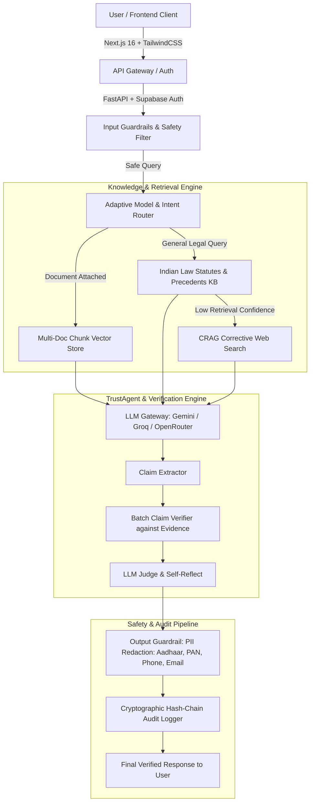

# ⚖️ NyayaPramaan
### *Verifiable, Citational, & Transparent AI Platform for Indian Law*

[](https://nextjs.org/)
[](https://fastapi.tiangolo.com/)
[](https://supabase.com/)
[](https://python.org)
[](https://www.typescriptlang.org/)

---

## 📌 Overview

**NyayaPramaan** is an enterprise-grade, verifiable legal AI platform tailored specifically for the Indian legal ecosystem (Constitution of India, IPC, BNS, CrPC, BNSS, CPC, and landmark Supreme Court & High Court judgments). 

It combines **Multi-Document RAG**, **TrustAgent™ claim-level verification**, **Cryptographic Hash-Chained Audit Logs**, **Automated Indian PII Redaction**, **3-Tier Multi-Model Fallbacks**, and an **Interactive 3D Advocate Guide** to ensure zero hallucinations and complete citational transparency.

---

## 🏛️ System Architecture



---

## ✨ Key Capabilities & Modules

### 1. 👩‍⚖️ Interactive 3D Lady Advocate Guide (*Advocate Nyaya Mitra*)
- **3D Perspective Entrance**: When opening the platform, a 3D-modeled Indian female advocate in traditional formal saree and advocate coat appears smoothly from the background into the foreground.
- **Speech Synthesis Narration**: Built-in Web Speech API voice narration explains platform features with real-time audio wave visualization and step-by-step guidance.
- **Interactive Tour**: Guides visitors through platform capabilities, document upload flows, and developer extension procedures.

### 2. 📂 Multi-Document Analysis & RAG
- **Fast Classification Preview**: Quickly assesses document legal relevance prior to full processing.
- **Background Pipeline**: Reads, summarizes, extracts timelines, and chunks documents into 768-dimensional embeddings (`gemini-embedding-001`).
- **Multi-Document Cross-Querying**: Attach multiple legal documents simultaneously in a single conversation.

### 3. 🛡️ TrustAgent™ Citation & Claim Verification
- Deconstructs LLM responses into discrete factual claims.
- Evaluates each claim directly against retrieved statutory provisions or court records.
- Categorizes citations as `verified`, `partial`, `contradicted`, or `unverified`.

### 4. ⛓️ Tamper-Evident Hash-Chain Audit Logging
- Every query, response, model selection, and verification verdict is appended to a SHA-256 hash-chain stored in the database.
- Provides cryptographic tamper-detection for administrative oversight and compliance.

### 5. 🔒 Multi-Layer Guardrails & Privacy
- **Input Guard**: Rejects prompt injections, malicious inputs, and out-of-domain queries.
- **Output Guard**: Automatically redacts sensitive Indian PII including **Aadhaar numbers**, **PAN cards**, **Phone numbers**, and **Email addresses**.

### 6. 🌐 Resilience: 3-Tier LLM Fallback Chain
- Intelligent fallback routing: `Gemini 3.6 Flash` ➔ `Groq (Llama / GPT-OSS)` ➔ `OpenRouter (DeepSeek R1)`.
- Handles rate-limits and outages seamlessly with automatic backoff and in-process response caching.

### 7. 🎮 Citizen & Student Tools
- **Rights-Rakshak Game**: Scenario-based interactive legal education with real-time scoring.
- **Daily Constitutional Quiz**: Dynamic 5-question daily quiz with judicial explanations.
- **Live Legal News Wire**: 24-hour curated feed of Indian judicial announcements and gazette updates.

---

## 🛠️ Tech Stack

- **Frontend**: Next.js 16 (App Router), React 19, TypeScript, Tailwind CSS, Lucide Icons.
- **Backend**: Python 3.11+, FastAPI, Pydantic, Uvicorn, LiteLLM, Google GenAI SDK.
- **Database & Auth**: Supabase PostgreSQL with `pgvector`, Row-Level Security (RLS), and JWT authentication.
- **Testing**: Pytest, FastAPI TestClient, TypeScript Type-Checking (`tsc`).

---

## 🚀 Getting Started

### 1. Prerequisites
- **Node.js** >= 18.x
- **Python** >= 3.11
- **Supabase Account** with pgvector enabled

---

### 2. Environment Configuration

#### Root / Backend `.env`
Create `.env` in the repository root:
```env
GEMINI_API_KEY=your_gemini_api_key
GROQ_API_KEY=your_groq_api_key
OPENROUTER_API_KEY=your_openrouter_api_key
SUPABASE_URL=https://your-project.supabase.co
SUPABASE_ANON_KEY=your_supabase_anon_key
SUPABASE_SERVICE_ROLE_KEY=your_supabase_service_role_key
```

#### Frontend `frontend/.env.local`
Create `frontend/.env.local`:
```env
NEXT_PUBLIC_API_BASE_URL=http://127.0.0.1:8000
NEXT_PUBLIC_SUPABASE_URL=https://your-project.supabase.co
NEXT_PUBLIC_SUPABASE_ANON_KEY=your_supabase_anon_key
```

---

### 3. Database Setup (Supabase)
Execute the SQL statements from [`supabase_schema_updates.sql`](./supabase_schema_updates.sql) in your Supabase SQL Editor to initialize:
- `cases` and `document_chunks` tables
- `session_documents` and `chat_sessions`
- `query_log` hash-chain table
- `match_document_chunks_multi` vector search RPC function

---

### 4. Running the Backend

```bash
# In the repository root
# Activate virtual environment
.\backend\venv\Scripts\activate   # Windows
# source backend/venv/bin/activate # Linux/macOS

# Install dependencies (if needed)
pip install -r requirements.txt

# Start the FastAPI server
python -m uvicorn backend.main:app --reload --host 127.0.0.1 --port 8000
```
Backend API will be live at: `http://127.0.0.1:8000` (Interactive Swagger Docs at `http://127.0.0.1:8000/docs`).

---

### 5. Running the Frontend

```bash
cd frontend

# Install dependencies
npm install

# Start Next.js development server
npm run dev
```
Frontend web application will be accessible at: `http://localhost:3000`.

---

## 🔄 Developer Guide: How to Extend & Update Features

Follow these clear architectural conventions whenever adding new functions or modules:

### Step 1: Adding a New Backend Endpoint
1. Create a router file inside `backend/routers/` (e.g., `backend/routers/contract_router.py`).
2. Define Pydantic request/response schemas and authentication dependencies (`Depends(get_current_user)`).
3. Register and mount the new router in `backend/main.py`:
   ```python
   from backend.routers import contract_router
   app.include_router(contract_router.router, prefix="/contract")
   ```

### Step 2: Adding a New AI Model or LLM Provider
1. Open `ai_core/llm_gateway.py`.
2. Add your new model identifier to `FALLBACK_CHAIN`:
   ```python
   FALLBACK_CHAIN = {
       "gemini": ["groq/openai/gpt-oss-20b", "openrouter/deepseek/deepseek-r1:free", "new_provider/model_id"],
       ...
   }
   ```
3. Ensure the provider API key is loaded into `os.environ` in `ai_core/llm_gateway.py`.

### Step 3: Adding Statutory Datasets or Knowledge Vectors
1. Add new text chunks or statutory acts in Supabase `statutes` / `judgments` table.
2. Generate embeddings using `ai_core/rag/embeddings.py` (`embed_text` or `embed_texts_batch`).
3. Update search queries in `ai_core/rag/vector_store.py`.

### Step 4: Connecting the Frontend Service & UI
1. Create a service file in `frontend/services/` (e.g., `frontend/services/contractService.ts`) utilizing the centralized `apiClient.ts` helper (`apiGet`, `apiPost`, `apiUpload`).
2. Build the corresponding page in `frontend/app/` using existing design tokens and UI components (`frontend/components/ui/`).

### Step 5: Validating with Automated Tests
Always execute the test suite to guarantee regression-free additions:
```bash
# Backend unit & integration tests
$env:PYTHONPATH="."
pytest tests/test_api.py -v

# Frontend TypeScript check and production build
cd frontend
npx tsc --noEmit
npm run build
```

---

## 🧪 Testing & Verification

### Automated Backend Tests
```bash
$env:PYTHONPATH="."
pytest tests/test_api.py -v
```
Expected output:
```
tests/test_api.py::test_health_endpoint PASSED
tests/test_api.py::test_input_guardrails_safety PASSED
tests/test_api.py::test_output_guardrails_pii_redaction PASSED
tests/test_api.py::test_intent_classification PASSED
tests/test_api.py::test_hash_chain_integrity PASSED
tests/test_api.py::test_document_classifier PASSED
6 passed in 37s (100% test pass rate)
```

### Frontend Type-Safety & Build
```bash
cd frontend
npx tsc --noEmit
npm run build
```
Expected output: `✓ Compiled successfully` with 37 static and dynamic routes.

---

## 📁 Repository Structure

```
Nyayapramaan/
├── ai_core/                    # AI Engine & Intelligence Core
│   ├── evaluation/             # LLM Judges, Quiz & Game Generators
│   ├── guardrails/             # Safety & PII (Aadhaar, PAN, Phone) filters
│   ├── rag/                    # Embeddings, chunkers, classifiers, vector store
│   ├── router/                 # Adaptive model routing & intent classifier
│   ├── timeline/               # Case event extraction
│   ├── trustagent/             # Fact verification & claim extraction
│   └── llm_gateway.py          # 3-tier resilient LLM gateway
├── backend/                    # FastAPI Application Services
│   ├── auth/                   # Supabase JWT validation & RBAC
│   ├── db/                     # Supabase storage & database interfaces
│   ├── models/                 # Pydantic schemas
│   ├── routers/                # Chat, Document, Case, Search, Quiz, News, Admin
│   └── main.py                 # FastAPI application entrypoint
├── frontend/                   # Next.js 16 (App Router) Client
│   ├── app/                    # Pages: /public/chat, /app/cases, /admin, /quiz, /game, etc.
│   ├── components/             # Reusable UI components, 3D Lady Advocate Guide, Navbars
│   ├── hooks/                  # useTheme, useAuth, useSession
│   ├── lib/                    # Supabase client & utilities
│   ├── public/images/          # 3D Avatar and static assets
│   └── services/               # API clients (chat, documents, cases, search, etc.)
├── tests/                      # Automated unit and integration test suite
├── trust_log/                  # Cryptographic SHA-256 hash-chain audit engine
├── supabase_schema_updates.sql # Supabase DB & pgvector migrations
├── requirements.txt            # Python dependencies
└── README.md                   # Full platform documentation (English)
```

---

## 📜 License
This project is built for legal transparency, verification, and research under the MIT License.
