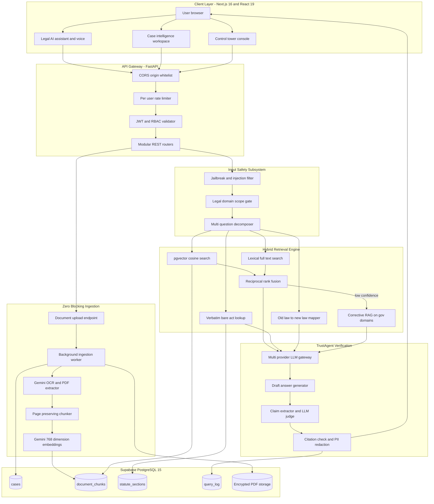
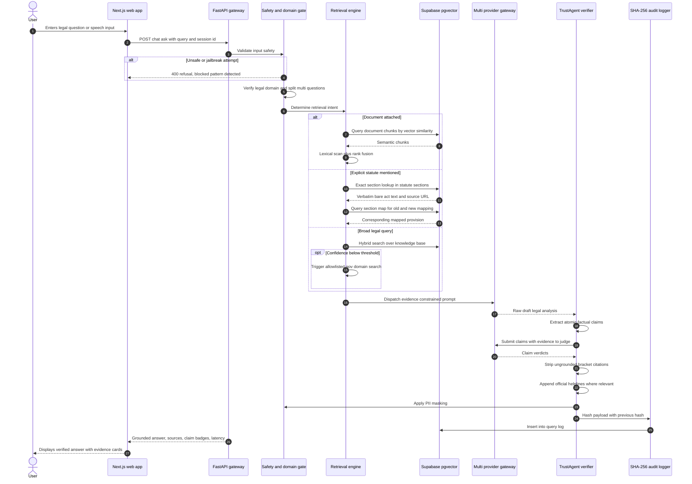
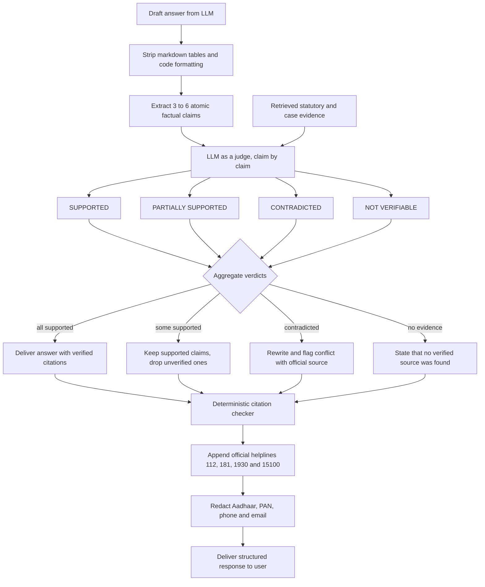
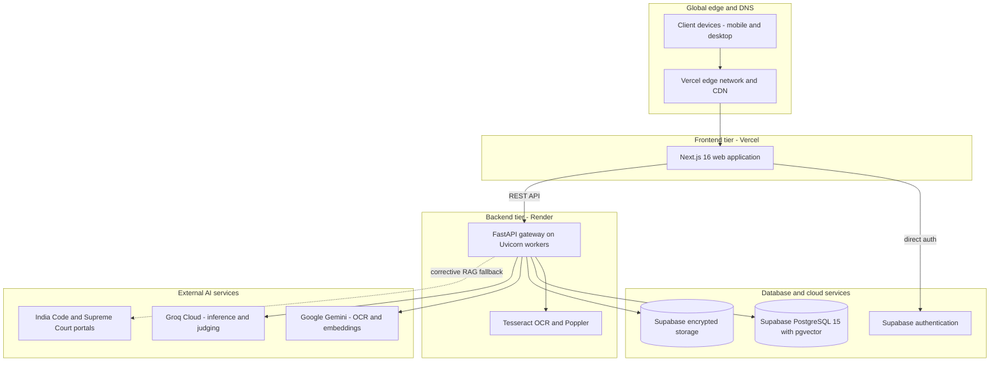

# ⚖️ NyayaPramaan (न्यायप्रमाण)

> **Verifiable, Citational, and Transparent AI Platform for the Indian Legal System**  
> *Built to reduce hallucinations in statutory interpretation, case analysis, and citizen rights navigation through deterministic grounding, multi-stage verification, and cryptographic auditability.*

[](https://github.com/tanisha-64/NyayaPramaan)
[](https://nextjs.org/)
[](https://react.dev/)
[](https://tailwindcss.com/)
[](https://fastapi.tiangolo.com/)
[](https://www.python.org/)
[](https://www.typescriptlang.org/)
[](https://supabase.com/)
[](https://ai.google.dev/)
[](https://groq.com/)
[](https://www.docker.com/)
[](https://github.com/tanisha-64/NyayaPramaan/actions)
[](https://opensource.org/licenses/MIT)

**Live Demo:** [nyaya-pramaan.vercel.app](https://nyaya-pramaan.vercel.app)

---

## 📑 Table of Contents

- [1. Project Overview](#1-project-overview)
- [2. Problem Statement](#2-problem-statement)
- [3. Objectives](#3-objectives)
- [4. Key Highlights](#4-key-highlights)
- [5. User Roles and Workspaces](#5-user-roles-and-workspaces)
- [6. High-Level System Architecture](#6-high-level-system-architecture)
- [7. Complete End-to-End Workflow](#7-complete-end-to-end-workflow)
- [8. AI/ML, RAG, and Conversion Architecture](#8-aiml-rag-and-conversion-architecture)
- [9. TrustAgent Verification Workflow](#9-trustagent-verification-workflow)
- [10. Document Ingestion Pipeline](#10-document-ingestion-pipeline)
- [11. Frontend Architecture](#11-frontend-architecture)
- [12. Backend Architecture](#12-backend-architecture)
- [13. Database Schema and Data Management](#13-database-schema-and-data-management)
- [14. Technology Stack](#14-technology-stack)
- [15. Project Directory Structure](#15-project-directory-structure)
- [16. API Specification and Endpoints](#16-api-specification-and-endpoints)
- [17. Authentication and Security](#17-authentication-and-security)
- [18. Local Installation and Setup](#18-local-installation-and-setup)
- [19. Environment Variables](#19-environment-variables)
- [20. Running the Application](#20-running-the-application)
- [21. Docker and Deployment](#21-docker-and-deployment)
- [22. Deployment Architecture](#22-deployment-architecture)
- [23. Testing and Evaluation Suite](#23-testing-and-evaluation-suite)
- [24. Troubleshooting](#24-troubleshooting)
- [25. Current Implementation Status](#25-current-implementation-status)
- [26. Known Limitations](#26-known-limitations)
- [27. Future Scope](#27-future-scope)
- [28. Contributing](#28-contributing)
- [29. License and Disclaimers](#29-license-and-disclaimers)
- [30. Authors and Contact](#30-authors-and-contact)

> **Architecture deep dives:** [AI, RAG and routing internals](docs/architecture.md) · [Data schema and security internals](docs/data-and-security.md)

---

## 1. Project Overview

**NyayaPramaan (न्यायप्रमाण)** is a citation-backed legal intelligence platform built for the Indian legal ecosystem. The name derives from Sanskrit: *Nyaya* (justice / legal reasoning) and *Pramaan* (proof / evidentiary grounds).

Unlike generic language models that produce plausible-sounding but fictitious sections and judgments, NyayaPramaan works on a **grounding-first** principle:

- Statements of law must resolve to verbatim gazette statutory text or official judicial records.
- Generated claims are broken into atomic factual units and verified against retrieved evidence before being shown.
- When verified authority cannot be retrieved, the system refuses to guess and points the user to official government sources and helplines.

The platform bridges the transition of India's criminal justice system that took effect on **1 July 2024**, supporting dual-statute lookups across:

- **Bharatiya Nyaya Sanhita (BNS), 2023** ↔ **Indian Penal Code (IPC), 1860**
- **Bharatiya Nagarik Suraksha Sanhita (BNSS), 2023** ↔ **Code of Criminal Procedure (CrPC), 1973**
- **Bharatiya Sakshya Adhiniyam (BSA), 2023** ↔ **Indian Evidence Act (IEA), 1872**
- **Code of Civil Procedure (CPC), 1908**, **Constitution of India**, **Negotiable Instruments Act, 1881**, and other central statutes.

---

## 2. Problem Statement

Deploying large language models in legal work exposes several systemic problems:

1. **Hallucinated legal provisions.** Generic LLMs fabricate section numbers, invent subsections, and hallucinate Supreme Court citations. In legal drafting, submitting a fake citation is professional misconduct.
2. **The 1 July 2024 statutory transition.** India replaced its colonial-era criminal codes. Models trained mainly on pre-2024 data conflate IPC with BNS, and miss that offences committed before 1 July 2024 remain governed by the IPC while later offences fall under the BNS.
3. **Information asymmetry for citizens.** Ordinary citizens face complex procedures for FIR filing, bail, and cheque dishonour notices, and are often turned away for lack of procedural knowledge.
4. **Heavy document bottlenecks.** Indian filings and judgments routinely run 100 to 300+ pages of scanned or degraded text. Naive RAG pipelines exhaust token budgets, stall the UI, or silently drop evidentiary pages.
5. **No verifiable audit trail.** Legal AI output usually leaves no tamper-evident record of what evidence an answer was grounded in at the time it was given.

---

## 3. Objectives

- **Grounding.** Ensure statutory citations, limitation periods, penalty amounts, and case law shown to users originate from verified source documents.
- **Bi-directional statutory conversion.** Deterministic cross-referencing between old enactments (IPC / CrPC / IEA) and new ones (BNS / BNSS / BSA) with cut-off date handling.
- **Democratised legal rights.** Plain-language, bilingual (English and Romanized Hinglish) guidance, procedural wizards, and voice-assisted workflows for citizens.
- **Advocate acceleration.** Fast case ingestion, automated case briefs, chronological timeline extraction, and hybrid precedent discovery for professionals.
- **Cryptographic transparency.** Log every inquiry, retrieved passage, generation, and verification verdict into a SHA-256 hash-chained ledger.

---

## 4. Key Highlights

| Pillar | Technical Implementation | Operational Impact |
| :--- | :--- | :--- |
| **Zero-wait ingestion** | Async FastAPI background worker, instant `200 OK`, real-time status polling | 150+ page case records upload without HTTP timeouts |
| **TrustAgent engine** | Atomic claim extractor, independent LLM judge, bracket citation stripper | Identifies and removes unbacked claims; per-claim verification badges |
| **Statute mapping** | 1,316 mapped entries across BNS, BNSS, BSA, IPC, CrPC, IEA (`data/section_map.csv`) | Instant conversion with change-type classification |
| **Multi-provider fallback** | 3-tier circuit-breaker gateway: Gemini → Groq → OpenRouter | Automatic failover when an upstream provider rate-limits |
| **Corrective RAG** | Hostname-strict domain allowlisting with PII pre-redaction | On low-confidence retrieval, searches only official `.gov.in` / `.nic.in` sources |
| **SHA-256 audit trail** | Hash chaining in Supabase `query_log` | Tamper-evident proof of retrieval integrity |
| **Indian PII shield** | Regex masking of Aadhaar, PAN, phone numbers, emails | Protects litigant data before cloud processing |

---

## 5. User Roles and Workspaces

Role-Based Access Control is enforced both at the API layer (`backend/auth/supabase_auth.py`) and the UI layer (`frontend/components/auth/RoleGuard.tsx`).

📐 **Role hierarchy diagram:** [docs/architecture.md → Role-based access control](docs/architecture.md#1-role-based-access-control)

| Feature / Workspace | Public (`public`) | Professional (`professional`) | Admin (`admin`) |
| :--- | :---: | :---: | :---: |
| Conversational legal AI and voice | ✅ | ✅ | ✅ |
| Multi-question decomposition | ✅ | ✅ | ✅ |
| Statute lookup (BNS / IPC) | ✅ | ✅ | ✅ |
| Case dossier ingestion | ❌ session-only | ✅ persistent | ✅ |
| Executive case brief generator | ❌ | ✅ | ✅ |
| Chronological timeline extractor | ❌ | ✅ | ✅ |
| Precedent search (SC and HC) | ❌ | ✅ | ✅ |
| Procedure wizards and deadline math | ✅ | ✅ | ✅ |
| Rights-Rakshak scenario game | ✅ | ✅ | ✅ |
| Daily quiz and legal news | ✅ | ✅ | ✅ |
| PDF chat export with Devanagari | ✅ | ✅ | ✅ |
| Admin metrics and health ops | ❌ 403 | ❌ 403 | ✅ |
| SHA-256 verification view | ✅ read | ✅ read | ✅ full audit |

---

## 6. High-Level System Architecture



---

## 7. Complete End-to-End Workflow



---

## 8. AI/ML, RAG, and Conversion Architecture

### 8.1 Multi-Tier LLM Gateway and Circuit Breaker

`ai_core/llm_gateway.py` implements a resilient fallback chain powered by `litellm`:

- **Tier 1** Google Gemini Flash → **Tier 2** Groq Cloud (Llama 3.3 / GPT-OSS) → **Tier 3** OpenRouter backup.
- **In-memory response caching.** Prompt and model are hashed into a SHA-256 key; identical queries return in under 5 ms. The cache holds up to 256 responses and is thread-safe.
- **Circuit breaker.** On an auth error, HTTP 429, or timeout, the gateway disables that provider for 60 seconds (`BREAKER_SECS = 60`) and routes traffic to the next tier without retry latency.
- If every tier fails, the user receives a graceful "service is busy" message rather than a fabricated answer.

📐 **Gateway flow diagram:** [docs/architecture.md → Multi-tier LLM gateway](docs/architecture.md#2-multi-tier-llm-gateway-and-circuit-breaker)

### 8.2 Section Mapping Engine (Old Law ↔ New Law)

`ai_core/rag/section_map.py` is backed by a database table populated from `data/section_map.csv`, containing **1,316 verified transitions**. The engine resolves a section in either direction and applies the 1 July 2024 cut-off rule.

For a query such as *"What is Section 302 IPC?"*, the system returns:

1. The historical IPC provision and its applicability to offences before 1 July 2024.
2. The BNS equivalent (**Section 103 BNS**) with substantive changes noted.
3. The official India Code source link and penalty parameters.

📐 **Mapping engine diagram:** [docs/architecture.md → Section mapping engine](docs/architecture.md#3-section-mapping-engine)

### 8.3 Corrective RAG (CRAG) and Self-RAG

When the best internal similarity score falls below `0.55`, the system does not guess. It redacts PII from the search terms, runs a bounded web search limited to three attempts, and filters results through a strict hostname allowlist — official `.gov.in` and `.nic.in` domains rank as primary authority, established legal portals rank as commentary, and everything else is discarded. A Self-RAG reflection step then rates usefulness and decides whether a bottom-line takeaway box is needed.

📐 **CRAG and Self-RAG diagram:** [docs/architecture.md → Corrective RAG and Self-RAG](docs/architecture.md#4-corrective-rag-and-self-rag)

---

## 9. TrustAgent Verification Workflow

`ai_core/trustagent/` sits between the generative model and the user, acting as an automated verification judge:



### TrustAgent Verdict Contract

| Status | Badge | Meaning | System behaviour |
| :--- | :---: | :--- | :--- |
| `verified` | ✅ Verified against source | All extracted propositions match statutory or judicial evidence | Delivered in full with page citations and links |
| `partial` | 🟡 Partially supported | Core premise accurate, peripheral details unmatched | Filtered to retain confirmed assertions only |
| `contradicted` | 🔴 Contradicted by source | Generation asserts facts disproven by the statute | Rewritten to remove contradiction and flag the conflict |
| `unverified` | ⚪ No evidence found | No matching bare act or precedent in the repository | Memory-only answers suppressed; refusal with helplines |
| `pending` | ⏳ Verification pending | Verification interrupted or timed out | Delivered with a clear disclaimer |

---

## 10. Document Ingestion Pipeline

Uploads never block the user. The request performs a legal-domain gate check, classifies the document, stores the raw file, generates a fast executive brief, and returns `200 OK` immediately — chunking and embedding continue in a background worker while the UI polls progress every three seconds.

- Accepted formats: PDF, DOCX, TXT and scanned images, up to 50 MB.
- Non-legal documents are rejected with `422` before any indexing cost is incurred.
- Progress is reported as `pages_processed` out of `total_pages`, with status `processing`, `ready` or `failed`.
- Interrupted runs can be resumed with the retry-indexing endpoint without re-uploading.

📐 **Ingestion sequence diagram:** [docs/data-and-security.md → Document ingestion pipeline](docs/data-and-security.md#3-document-ingestion-pipeline)

---

## 11. Frontend Architecture

Built on **Next.js 16 (App Router)** and **React 19**, styled with **Tailwind CSS v4**.

```text
frontend/app/
├── layout.tsx                     # Root layout, theme providers and fonts
├── page.tsx                       # Landing page
├── globals.css                    # Tailwind v4 directives and animations
├── login/page.tsx                 # Supabase authentication sign-in
├── register/page.tsx              # Registration with role selection
├── how-it-works/page.tsx          # Walkthrough of the verification flow
├── trust-verification/page.tsx    # Trust and verification architecture viewer
├── game/page.tsx                  # Rights-Rakshak scenario game
├── quiz/page.tsx                  # Daily legal quiz with streaks
├── news/page.tsx                  # Live Indian legal news radar
├── admin/page.tsx                 # Control tower and health monitoring
├── public/
│   ├── chat/page.tsx              # Bilingual research assistant with voice
│   └── saved/page.tsx             # Saved answers and citations
└── app/
    └── dashboard/page.tsx         # Professional case and precedent workspace
```

**Key components and services**

- `AnswerCard.tsx` — verified answers, expandable source tabs, verdict badges, bottom-line callouts.
- `WizardModal.tsx` — tree-walking modal for FIR refusals, bail options, scam checks, cheque-bounce deadlines.
- `ChatSidebar.tsx` — session manager with rename, pin, and history retrieval.
- `useVoiceInput.ts` — speech-to-text via the browser Web Speech API (English and Hindi).
- `useVoiceOutput.ts` — text-to-speech with rate and pitch controls.
- `apiClient.ts` — centralised HTTP client handling JWT attachment and structured error parsing.

---

## 12. Backend Architecture

FastAPI (Python 3.11+), organised into decoupled service layers:

```text
backend/
├── main.py                        # Entrypoint, CORS, router registration
├── auth/supabase_auth.py          # JWT validation, role resolution, admin whitelist
├── db/supabase_storage.py         # Supabase cloud storage operations
├── sql/
│   └── hybrid_search_functions.sql # Reference copy of the pgvector search functions
├── eval/
│   ├── run_eval.py                # Accuracy, retrieval and faithfulness runner
│   └── test_cases.json            # Regression test cases
├── routers/
│   ├── chat_router.py             # Chat sessions, multi-question QA, PDF export
│   ├── document_router.py         # Uploads, background indexing, status polling
│   ├── case_router.py             # Case CRUD, executive brief, notes, timeline
│   ├── wizard_router.py           # Procedure trees and Section 138 deadline math
│   ├── search_router.py           # Precedent search by court, year, jurisdiction
│   ├── admin_router.py            # Metrics, IST active users, health ping
│   ├── quiz_router.py             # Daily quiz caching and generation
│   ├── news_router.py             # Legal news aggregation with topic-based images
│   ├── game_router.py             # Scenario generator, streaks, scoring
│   └── tools_router.py            # Cheque deadline calculator, scope info
└── wizards/wizard_definitions.py  # Declarative procedural trees and checklists
```

---

## 13. Database Schema and Data Management

PostgreSQL 15+ on Supabase with the `pgvector` extension. Core tables: `cases`, `document_chunks` (with a `vector(768)` embedding column), `chat_sessions`, `chat_messages`, `session_documents`, `statute_sections`, `section_map`, `query_log` and `user_game_progress`.

📐 **Full entity-relationship diagram:** [docs/data-and-security.md → Database schema](docs/data-and-security.md#1-database-schema)

### Database RPC Functions

| Function | Purpose |
| :--- | :--- |
| `match_document_chunks(query_embedding, target_case_id, match_count)` | Cosine similarity over chunks belonging to one case |
| `match_document_chunks_multi(query_embedding, target_case_ids, match_count)` | Similarity matching across multiple dossiers |
| `hybrid_search_judgments(query_embedding, query_text, match_count)` | Blends vector proximity with full-text ranking on landmark cases |
| `hybrid_search_statutes(query_embedding, query_text, match_count)` | Full-text ranking over statutory provisions with an exact section-number boost |

A reference copy of these definitions lives at `backend/sql/hybrid_search_functions.sql`. Re-run it in the Supabase SQL Editor whenever the database is rebuilt, then run `NOTIFY pgrst, 'reload schema';`.

---

## 14. Technology Stack

### Frontend

| Technology | Purpose | Where used | Why |
| :--- | :--- | :--- | :--- |
| Next.js 16 | Application framework | `frontend/` | App Router, server components, fast client navigation |
| React 19 | UI library | `frontend/components/` | Modern primitives and concurrent rendering |
| Tailwind CSS v4 | Utility-first CSS | `frontend/app/globals.css` | Compiled styles with no runtime overhead |
| TypeScript 5 | Type safety | All `.ts` / `.tsx` files | Enforces contracts across API and component props |
| Lucide React | Iconography | Navigation, cards, modals | Lightweight, consistent icon set |
| Web Speech API | Voice input and output | `useVoiceInput.ts`, `useVoiceOutput.ts` | Native browser STT and TTS with no third-party keys |

### Backend

| Technology | Purpose | Where used | Why |
| :--- | :--- | :--- | :--- |
| FastAPI | REST framework | `backend/main.py`, routers | Async handling, OpenAPI docs, Pydantic validation |
| Uvicorn | ASGI server | Runtime | High-throughput async HTTP |
| Pydantic v2 | Validation | Request and response models | Runtime validation and fast serialisation |
| fpdf2 | PDF generation | `chat_router.py` | Pure-Python PDF with Devanagari TTF support |
| python-dotenv | Configuration | Entrypoint and utilities | Twelve-Factor style local `.env` loading |

### AI / ML and RAG

| Technology | Purpose | Where used | Why |
| :--- | :--- | :--- | :--- |
| google-genai | OCR and embeddings | `embeddings.py`, `document_reader.py` | Official SDK for `gemini-embedding-001` and vision OCR |
| LiteLLM | Universal LLM proxy | `llm_gateway.py` | One interface across Gemini, Groq and OpenRouter |
| Groq SDK | Fast inference | `llm_gateway.py`, `llm_judge.py` | Low-latency claim extraction and judging |
| ddgs | Web search | `crag_corrector.py` | Key-free search of authoritative Indian legal portals |
| PyPDF / pdf2image | Local PDF parsing | `document_chunker.py` | Fast extraction before OCR fallback |
| pytesseract | Fallback OCR | `backend/Dockerfile` | Local OCR when external APIs are unreachable |
| Langfuse / Ragas | Observability and evaluation | `requirements.txt`, `backend/eval/` | Tracing and retrieval evaluation metrics |

### Data and Infrastructure

| Technology | Purpose | Why |
| :--- | :--- | :--- |
| Supabase (PostgreSQL 15) | Managed database and auth | Relational storage with Row-Level Security |
| pgvector | Vector similarity | In-database cosine indexing on `vector(768)` |
| Supabase Storage | Object storage | Secure storage for raw case files |
| Docker and Compose | Container orchestration | Uniform execution across environments |

---

## 15. Project Directory Structure

```text
NyayaPramaan/
├── .github/workflows/ci.yml           # CI: backend pytest and frontend build
├── ai_core/                           # Core AI, RAG and verification engine
│   ├── evaluation/
│   │   ├── llm_judge.py               # Claim-by-claim evidence verifier
│   │   ├── news_fetcher.py            # Legal news aggregator via RSS
│   │   ├── quiz_generator.py          # Daily quiz generator
│   │   └── rights_game_generator.py   # Scenario generator and score keeper
│   ├── formatting/
│   │   ├── answer_style.py            # Plain-language style enforcement
│   │   └── grounding.py               # Deterministic stripper for unbacked facts
│   ├── guardrails/
│   │   ├── input_guard.py             # Jailbreak and prompt-injection detector
│   │   └── output_guard.py            # PII redactor
│   ├── rag/
│   │   ├── case_text_fallback.py      # Lexical scan fallback
│   │   ├── cheque_deadlines.py        # Section 138 deadline logic
│   │   ├── crag_corrector.py          # Corrective RAG with gov allowlist
│   │   ├── document_chunker.py        # Page-preserving chunker and indexer
│   │   ├── document_classifier.py     # Legal document classifier
│   │   ├── document_reader.py         # Extraction with Gemini OCR fallback
│   │   ├── embeddings.py              # Gemini 768-dim embedder
│   │   ├── legal_scope.py             # Legal domain verifier
│   │   ├── section_map.py             # Old law to new law mapper
│   │   ├── self_rag.py                # Self-critique and bottom-line extraction
│   │   ├── statutes.py                # Bare act verbatim lookup
│   │   ├── summarizer.py              # Windowed case summariser
│   │   └── vector_store.py            # pgvector client and hybrid search RPCs
│   ├── router/
│   │   ├── adaptive_router.py         # Task-to-model dispatcher
│   │   ├── domain_gate.py             # Scope classification and greetings
│   │   ├── intent_classifier.py       # Citizen vs professional audience
│   │   └── multi_question.py          # Question decomposer and answer merger
│   ├── timeline/extractor.py          # Date-and-event extraction
│   ├── trustagent/
│   │   ├── citations.py               # Citation validator and bracket stripper
│   │   ├── claim_extractor.py         # Atomic claim deconstruction
│   │   └── corrector.py               # Answer rewriter and helpline recommender
│   └── llm_gateway.py                 # 3-tier fallback gateway with circuit breaker
├── backend/                           # FastAPI application
│   ├── auth/supabase_auth.py
│   ├── db/supabase_storage.py
│   ├── sql/hybrid_search_functions.sql
│   ├── eval/
│   ├── routers/
│   ├── wizards/wizard_definitions.py
│   ├── Dockerfile
│   └── main.py
├── data/section_map.csv               # 1,316 statutory mapping rows
├── docs/
│   ├── architecture.md                # AI, RAG and routing deep dive
│   ├── data-and-security.md           # Schema, auth, ingestion and container diagrams
│   ├── implementation_plan.md
│   └── walkthrough.md
├── frontend/                          # Next.js 16 application
│   ├── app/  components/  hooks/  lib/  services/
│   ├── Dockerfile  package.json  postcss.config.mjs  tsconfig.json
├── scripts/
│   ├── bench.py                       # Latency and citation accuracy benchmark
│   ├── ingest_statutes.py             # Bare act PDF ingestor
│   └── load_section_map.py            # CSV importer for section_map
├── sql/                               # Additional database migration scripts
├── tests/test_api.py                  # End-to-end API tests
├── trust_log/hash_chain.py            # SHA-256 chain constructor and validator
├── .env.example                       # Environment variable template (no real keys)
├── docker-compose.yml
├── pytest.ini
├── requirements.txt
├── supabase_schema_updates.sql        # Tables, migrations and RPC functions
└── README.md
```

---

## 16. API Specification and Endpoints

Protected endpoints require: `Authorization: Bearer <supabase-jwt-access-token>`

### Chat (`/chat`)

| Method | Endpoint | Access | Description |
| :--- | :--- | :--- | :--- |
| `POST` | `/chat/ask` | Authenticated | Primary Q&A. Handles multi-question splitting, hybrid retrieval, verification, PII masking |
| `GET` | `/chat/sessions` | Authenticated | Lists sessions sorted by pinned status and update time |
| `POST` | `/chat/sessions` | Authenticated | Creates a new chat session |
| `GET` | `/chat/sessions/{id}/messages` | Authenticated | Message history, sources and linked documents |
| `PATCH` | `/chat/sessions/{id}` | Authenticated | Renames a session or toggles pinning |
| `DELETE` | `/chat/sessions/{id}` | Authenticated | Deletes a session and its messages |
| `DELETE` | `/chat/sessions/{id}/messages/from/{msg_id}` | Authenticated | Deletes a message and everything after it, for edit-and-resend |
| `GET` | `/chat/debug/case/{case_id}` | Case owner | Diagnostic probe for chunk count and RPC availability |

### Documents (`/document`)

| Method | Endpoint | Access | Description |
| :--- | :--- | :--- | :--- |
| `POST` | `/document/upload` | Authenticated | Accepts PDF, DOCX, TXT or scanned images; legal gate check and async indexing |
| `GET` | `/document/{case_id}/status` | Case owner | Live ingestion progress |
| `POST` | `/document/{case_id}/retry-indexing` | Case owner | Re-triggers chunking and embedding |
| `DELETE` | `/document/{case_id}` | Case owner | Deletes the case file, text and vector chunks |

### Cases (`/case`)

| Method | Endpoint | Access | Description |
| :--- | :--- | :--- | :--- |
| `GET` | `/case/list` | Authenticated | Lists the user's dossiers |
| `GET` | `/case/{case_id}` | Case owner | Full record with text, summary, timeline and notes |
| `PUT` | `/case/{case_id}/notes` | Case owner | Updates practitioner notes |
| `POST` | `/case/{case_id}/regenerate-summary` | Case owner | Re-runs summarisation after a provider failure |
| `GET` | `/case/{case_id}/brief` | Case owner | Executive case brief with ratio decidendi |
| `DELETE` | `/case/{case_id}` | Case owner | Removes a single case |
| `DELETE` | `/case/clear/all` | Case owner | Bulk clears all cases and chunks |

### Wizards (`/wizards`)

| Method | Endpoint | Access | Description |
| :--- | :--- | :--- | :--- |
| `GET` | `/wizards/list` | Authenticated | Lists available procedure wizards |
| `GET` | `/wizards/{wizard_id}` | Authenticated | Full branching decision tree and checklists |
| `POST` | `/wizards/cheque-bounce/deadline` | Authenticated | Section 138 limitation dates |

### Admin (`/admin`)

| Method | Endpoint | Access | Description |
| :--- | :--- | :--- | :--- |
| `GET` | `/admin/metrics` | Admin | Query totals, verification rates, model usage |
| `GET` | `/admin/judgments-count` | Admin | Indexed landmark judgment count |
| `GET` | `/admin/activity` | Admin | Registered and today's active users (midnight IST) |
| `GET` | `/admin/health` | Admin | Database, index and LLM gateway health probe |

### Utilities

| Method | Endpoint | Access | Description |
| :--- | :--- | :--- | :--- |
| `GET` | `/quiz/today` | Public | Today's cached quiz or a newly generated one |
| `GET` | `/news/legal` | Public | Legal news from RSS, sorted newest first, with topic-themed images |
| `GET` | `/game/scenario` | Public | A legal rights decision scenario |
| `POST` | `/game/answer` | Optional auth | Submits a choice and updates points and streaks |
| `GET` | `/game/progress` | Optional auth | Cumulative score, streak and tier |
| `POST` | `/tools/cheque-deadlines` | Authenticated | NI Act 1881 timeline calculator |
| `GET` | `/tools/scope` | Authenticated | Supported legal domains and starter questions |
| `POST` | `/search/precedents` | Authenticated | Precedent search with court and year filters |
| `GET` | `/health` | Public | Baseline health probe returning `{"status": "ok"}` |

---

## 17. Authentication and Security

Every request passes through JWT validation, role resolution, route permission checks, per-user rate limiting and an input guardrail scan before reaching business logic.

📐 **Full request-security flow diagram:** [docs/data-and-security.md → Authentication and security flow](docs/data-and-security.md#2-authentication-and-security-flow)

### Security and Privacy Controls

1. **Anti-escalation.** Even if a user edits their Supabase `user_metadata` to claim `{"role": "admin"}`, `backend/auth/supabase_auth.py` requires the email to be listed in the `ADMIN_EMAILS` environment variable. Unauthorised attempts are demoted to `public`.
2. **Deterministic PII redaction.** Before any response reaches the user or the audit ledger, `ai_core/guardrails/output_guard.py` masks Aadhaar numbers, PAN numbers, Indian phone numbers and email addresses.
3. **CORS hardening.** `backend/main.py` whitelists trusted origins and reads additional ones from `FRONTEND_URL` and `ALLOWED_ORIGINS`.
4. **Rate limiting.** A per-user token bucket returns `429` with a `Retry-After` header when the request budget is exceeded.
5. **No secrets in the repository.** All credentials are supplied through environment variables. `.env` is gitignored and `.env.example` contains placeholders only — never commit real keys, and rotate any key that is accidentally exposed.

---

## 18. Local Installation and Setup

### Prerequisites

- **Python** 3.11 or higher
- **Node.js** 20 or higher, with npm 10+
- **Git**
- **Supabase account** with a PostgreSQL project and `pgvector` enabled
- **OCR binaries** (optional, for local OCR):
  - Ubuntu/Debian: `sudo apt-get install tesseract-ocr poppler-utils`
  - macOS: `brew install tesseract poppler`
  - Windows: Tesseract (UB-Mannheim build) and Poppler for Windows

### 1. Clone

```bash
git clone https://github.com/tanisha-64/NyayaPramaan.git
cd NyayaPramaan
```

### 2. Backend

**Windows (PowerShell):**
```powershell
python -m venv venv
.\venv\Scripts\Activate.ps1
python -m pip install --upgrade pip
pip install -r requirements.txt
```

**Linux / macOS:**
```bash
python3 -m venv venv
source venv/bin/activate
pip install --upgrade pip
pip install -r requirements.txt
```

### 3. Frontend

```bash
cd frontend
npm install
cd ..
```

### 4. Database

1. Open your project in the Supabase dashboard and go to the **SQL Editor**.
2. Run the contents of `supabase_schema_updates.sql`.
3. Run `backend/sql/hybrid_search_functions.sql` to create the search RPCs.
4. Run `NOTIFY pgrst, 'reload schema';` so the REST API picks up the new functions.
5. Optionally load the statutory mapping dataset:
   ```bash
   python scripts/load_section_map.py data/section_map.csv
   ```

---

## 19. Environment Variables

Create a root-level `.env` from the template:

```bash
cp .env.example .env
```

> ⚠️ Every value below is a **placeholder**. Fill them in locally and never commit `.env` or paste real keys into issues, screenshots or documentation.

| Variable | Required | Example value | Description |
| :--- | :---: | :--- | :--- |
| `SUPABASE_URL` | Yes | `https://<your-project-ref>.supabase.co` | Project URL from Supabase Settings → API |
| `SUPABASE_ANON_KEY` | Yes | `<your-supabase-anon-key>` | Public anonymous key |
| `SUPABASE_SERVICE_ROLE_KEY` | Yes | `<your-supabase-service-role-key>` | Server-side key — never expose to the browser |
| `GEMINI_API_KEY` | Yes | `<your-gemini-api-key>` | Google AI Studio key for OCR and embeddings |
| `GROQ_API_KEY` | Yes | `<your-groq-api-key>` | Groq key for inference and claim judging |
| `OPENROUTER_API_KEY` | Optional | `<your-openrouter-api-key>` | Third-tier fallback provider |
| `GEMINI_MODEL` | Optional | `gemini/gemini-3.6-flash` | LiteLLM identifier for primary inference |
| `GROQ_MODEL` | Optional | `groq/openai/gpt-oss-20b` | LiteLLM identifier for secondary inference |
| `ADMIN_EMAILS` | Optional | `<your-admin-email>` | Comma-separated emails granted the `admin` role |
| `FRONTEND_URL` | Optional | `http://localhost:3000` | Allowed CORS origin |
| `ALLOWED_ORIGINS` | Optional | `http://localhost:3000` | Additional comma-separated CORS origins |
| `NEXT_PUBLIC_API_BASE_URL` | Yes | `http://localhost:8000` | Backend base URL used by the client |
| `NEXT_PUBLIC_SUPABASE_URL` | Yes | `https://<your-project-ref>.supabase.co` | Supabase URL for the browser client |
| `NEXT_PUBLIC_SUPABASE_ANON_KEY` | Yes | `<your-supabase-anon-key>` | Anonymous key for the browser client |
| `NEXT_PUBLIC_ADMIN_EMAIL` | Optional | `<your-admin-email>` | Admin contact shown in the UI |

---

## 20. Running the Application

### Backend

**Windows (PowerShell):**
```powershell
.\venv\Scripts\Activate.ps1
uvicorn backend.main:app --host 127.0.0.1 --port 8000 --reload
```

**Linux / macOS:**
```bash
source venv/bin/activate
uvicorn backend.main:app --host 127.0.0.1 --port 8000 --reload
```

- Swagger UI: `http://127.0.0.1:8000/docs`
- ReDoc: `http://127.0.0.1:8000/redoc`
- Health probe: `http://127.0.0.1:8000/health`

### Frontend

```bash
cd frontend
npm run dev
```

- Web app: `http://localhost:3000`

---

## 21. Docker and Deployment

The repository ships a two-container setup: a `node:20-alpine` frontend on port 3000 and a `python:3.11-slim` backend (with Tesseract and Poppler) on port 8000. Both read configuration from the root `.env`.

```bash
docker compose up --build     # build and start
docker compose up -d          # detached
docker compose down           # stop everything
```

📐 **Container topology diagram:** [docs/data-and-security.md → Docker container topology](docs/data-and-security.md#4-docker-container-topology)

---

## 22. Deployment Architecture



---

## 23. Testing and Evaluation Suite

### Pytest

```bash
python -m pytest tests/ -v
```

What the tests verify:

- `test_health_endpoint` — baseline HTTP 200 and JSON availability
- `test_input_guardrails_safety` — jailbreak and prompt-extraction attempts are blocked
- `test_output_guardrails_pii_redaction` — Aadhaar and phone numbers are masked
- `test_intent_classification` — legal queries route correctly, off-topic queries are refused
- `test_hash_chain_integrity` — SHA-256 continuity across consecutive ledger entries
- `test_document_classifier` — landmark judgment filenames and court citation formats are recognised
- `test_cors_preflight_and_case_list_headers` — preflight behaviour matches production origins
- `test_document_upload_and_status_endpoint_success` — end-to-end upload and status polling

### Faithfulness and Retrieval Evaluation

```bash
python -m backend.eval.run_eval
```

Evaluates three dimensions against `backend/eval/test_cases.json`:

1. **Citation accuracy** — do retrieved provisions match the expected statute and section?
2. **Retrieval quality** — do multi-page queries retrieve the correct page numbers?
3. **Faithfulness** — an LLM judge checks that answers are supported by retrieved evidence.

### Benchmark Script

```powershell
$env:TOKEN="<your-supabase-jwt-token>"
$env:BASE_URL="http://127.0.0.1:8000"
python scripts/bench.py
```

---

## 24. Troubleshooting

| Symptom | Likely cause | Fix |
| :--- | :--- | :--- |
| Search returns nothing in the UI, but the same query works in the SQL Editor | The browser shows a CORS error because an unhandled backend exception escaped before CORS headers were added. Check the deployment logs for the real traceback. | Fix the underlying error. A common one is a search function whose `search_path` omits `extensions`, so the pgvector `<=>` operator cannot resolve. |
| `operator does not exist: extensions.vector <=> extensions.vector` | The RPC function's `search_path` does not include the schema where pgvector is installed | Re-run `backend/sql/hybrid_search_functions.sql`, which sets `search_path` to `public, extensions, pg_temp` |
| A newly created or altered RPC is not visible to the API | PostgREST is serving a stale schema cache | Run `NOTIFY pgrst, 'reload schema';` in the Supabase SQL Editor |
| First request after idle takes 50+ seconds or fails | Free-tier backend instances spin down when idle | Wait for the cold start, keep the service warm with a periodic `/health` ping, or move to a paid instance |
| Legal news shows stale articles | A day's results are cached in `daily_news`; a cached fallback set can persist for the rest of that day | Clear the cache with `DELETE FROM daily_news WHERE news_date = CURRENT_DATE;` and reload |
| Exported PDF drops Hindi characters | No Devanagari TrueType font found on the host | Install `NotoSansDevanagari`, `Nirmala.ttf` or `Mangal.ttf`, or ship the font with the project |
| A Mermaid diagram shows "Unable to render rich display" or "svg element not in render tree" | GitHub renders only a limited number of Mermaid diagrams per page; later ones fail even when the syntax is valid | Keep at most four diagrams per Markdown file — that is why the deep-dive diagrams live in `docs/architecture.md` and `docs/data-and-security.md` |

---

## 25. Current Implementation Status

| Feature | Status | Source | Notes |
| :--- | :---: | :--- | :--- |
| Bilingual legal assistant | 🟢 Complete | `chat_router.py` | English and Romanized Hinglish |
| TrustAgent claim verification | 🟢 Complete | `ai_core/trustagent/` | Atomic extraction, LLM judge, citation checks |
| Old ↔ new law mapping | 🟢 Complete | `section_map.py` | 1,316 mapped entries |
| Zero-wait document ingestion | 🟢 Complete | `document_router.py` | Background processing with live progress |
| Input / output guardrails | 🟢 Complete | `ai_core/guardrails/` | Injection detection and PII masking |
| SHA-256 audit ledger | 🟢 Complete | `trust_log/hash_chain.py` | Chained logging in `query_log` |
| Procedure wizards (4 flows) | 🟢 Complete | `backend/wizards/` | FIR refusal, bail, cheque bounce, scam check |
| Cheque bounce deadline calculator | 🟢 Complete | `cheque_deadlines.py` | 30-day notice, 15-day cure, 30-day filing |
| Rights-Rakshak scenario game | 🟢 Complete | `rights_game_generator.py` | Levels, streaks and scores |
| Daily quiz and legal news | 🟢 Complete | `quiz_router.py`, `news_router.py` | Date-sorted RSS with topic-themed images |
| PDF chat export (Devanagari) | 🟢 Complete | `chat_router.py` | `fpdf2` with auto-detected TTF |
| Superadmin operations console | 🟢 Complete | `admin_router.py` | Health ping, IST active users, accuracy rates |
| Voice input and text-to-speech | 🟢 Complete | `useVoiceInput.ts`, `useVoiceOutput.ts` | Native Web Speech API |
| Multi-question split and merge | 🟢 Complete | `multi_question.py` | Decomposes compound queries |
| Precedent court/year filtering | 🟡 Partial | `search_router.py` | API filtering complete; UI embedded in the dashboard |
| User settings document manager | 🟡 Partial | `frontend/app/app/settings/page.tsx` | Placeholder page |
| Full High Court bare acts sync | 🔵 Planned | `scripts/ingest_statutes.py` | Central acts indexed; state amendments planned |
| Multi-party collaborative dossiers | 🔵 Planned | In design | Real-time collaboration on active cases |

---

## 26. Known Limitations

1. **State-level statutory variations.** Central acts are mapped comprehensively, but state amendments are currently advisory commentary rather than database rows.
2. **Severely degraded scans.** Pre-independence records or carbon-copy FIRs with tears and ink-bleed yield low OCR confidence; clear digital scans work far better.
3. **Web search rate limits.** The corrective RAG fallback uses headless search and can hit transient throttling under heavy concurrent use.
4. **Devanagari font fallback.** Without a Devanagari TrueType font on the host, exported PDFs strip unsupported glyphs rather than crashing.
5. **Statute search is keyword-based.** `hybrid_search_statutes` ranks on full-text relevance with an exact section-number boost; it does not yet use vector similarity, so conceptual queries match less precisely than section-number queries.

---

## 27. Future Scope

- **State act integration.** Extend the bare act database to state tenancy, police and land revenue acts.
- **Vernacular expansion.** Native Devanagari, Tamil, Telugu, Bengali and Marathi generation alongside Romanized Hinglish.
- **Semantic statute search.** Add vector similarity to `hybrid_search_statutes` so conceptual queries rank as well as section-number lookups.
- **Court filing formatter.** Pre-formatted templates for vakalatnamas, anticipatory bail applications and Section 138 demand notices.
- **Offline self-hosted LLMs.** A Docker profile using quantized local models for air-gapped deployments.

---

## 28. Contributing

1. Fork the repository and create a branch: `git checkout -b feature/your-feature`
2. Follow PEP 8 for Python and ESLint / Prettier for TypeScript.
3. Run the tests:
   ```bash
   python -m pytest tests/ -v
   cd frontend && npm run build
   ```
4. Open a pull request describing the change, its grounding impact, and test results.

Never include real API keys, tokens or `.env` contents in a pull request or issue.

---

## 29. License and Disclaimers

### License

Distributed under the **MIT License**.

### Legal Disclaimer

> [!IMPORTANT]
> **NyayaPramaan is an AI-powered legal information and research platform, not a licensed legal practitioner or law firm.**
> The information, statutory cross-references, timelines and checklists it provides are for academic, research and informational assistance only. They do not constitute legal advice, representation, or an attorney-client relationship under the Advocates Act, 1961. For active disputes or criminal proceedings, verify provisions against the official Gazette of India and consult a certified advocate or the National Legal Services Authority (NALSA helpline **15100**, [nalsa.gov.in](https://nalsa.gov.in)).

---

## 30. Authors and Contact

- **Lead Developer:** Tanisha Gupta ([@tanisha-64](https://github.com/tanisha-64))
- **Repository:** [github.com/tanisha-64/NyayaPramaan](https://github.com/tanisha-64/NyayaPramaan)
- **Live Deployment:** [nyaya-pramaan.vercel.app](https://nyaya-pramaan.vercel.app)

---

<p align="center">
  <b>NyayaPramaan (न्यायप्रमाण)</b> • <i>Verifiable, citational and transparent legal intelligence for India</i>
</p>
