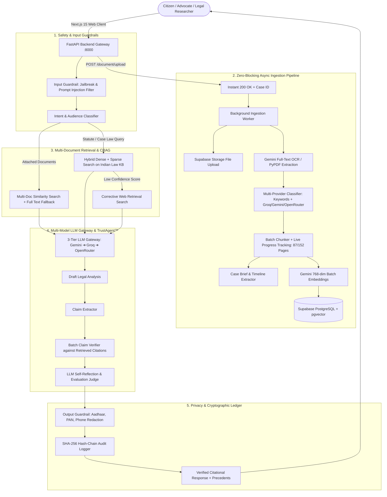
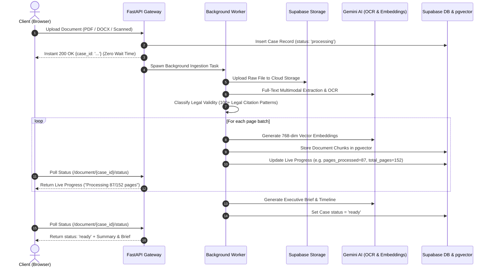
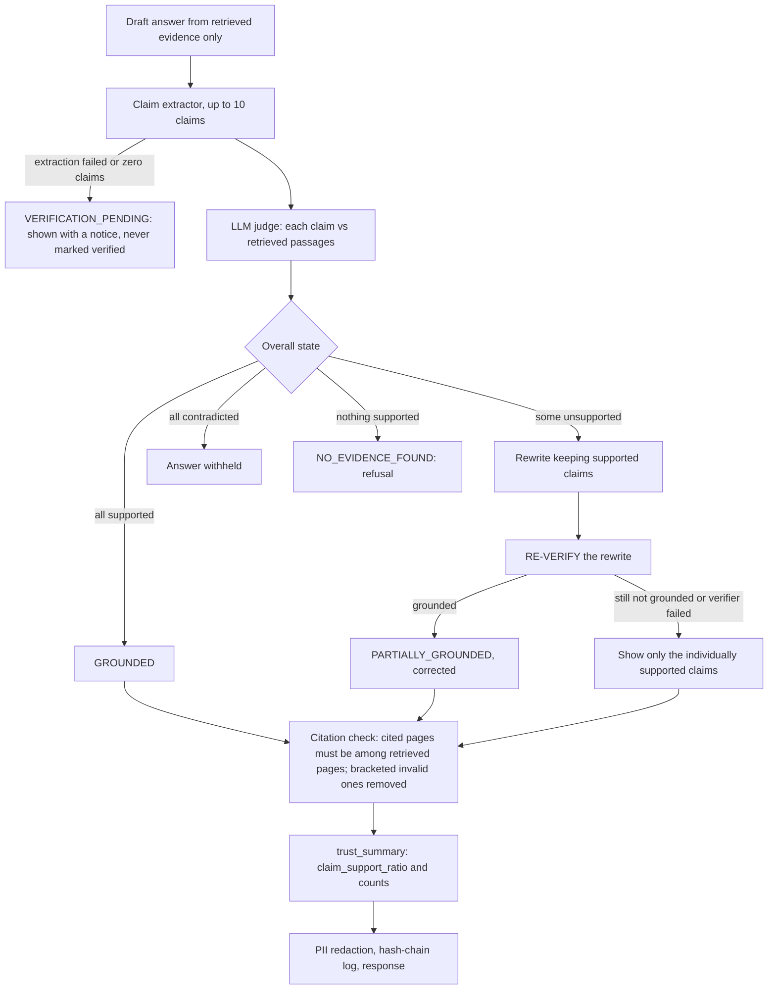

# ⚖️ NyayaPramaan (न्यायप्रमाण)
### *Enterprise Verifiable, Citational, & Transparent AI Platform for Indian Law*

[](https://nextjs.org/)
[](https://fastapi.tiangolo.com/)
[](https://supabase.com/)
[](https://python.org)
[](https://www.typescriptlang.org/)
[](https://www.docker.com/)
[](https://opensource.org/licenses/MIT)

---

## 📌 Executive Overview

**NyayaPramaan** is a production-grade, verifiable legal AI platform architected specifically for the Indian legal framework. It encompasses the **Constitution of India**, **Indian Penal Code (IPC)**, **Bharatiya Nyaya Sanhita (BNS)**, **Code of Criminal Procedure (CrPC)**, **Bharatiya Nagarik Suraksha Sanhita (BNSS)**, **Code of Civil Procedure (CPC)**, **Bharatiya Sakshya Adhiniyam (BSA)**, alongside landmark rulings from the **Supreme Court of India** and all State **High Courts**.

The platform prevents legal hallucinations through:
1. **Multi-Document Ingestion & RAG** with zero-block async uploads and live page tracking.
2. **TrustAgent™ Claim-Level Verification** directly anchoring AI statements to statutory citations.
3. **Cryptographic SHA-256 Hash-Chained Audit Ledger** for tamper-evident compliance.
4. **Automated Indian PII Redaction** (Aadhaar, PAN, Phone, Email masking).
5. **3-Tier Multi-Provider LLM Fallbacks** (Google Gemini ➔ Groq ➔ OpenRouter).

---

## 🏛️ Comprehensive System Architecture



---

## 🔄 Document Upload & Processing Lifecycle



---

## 🛡️ TrustAgent™ Claim Verification Flow



`trust_summary.claim_support_ratio = (supported + 0.5 x partially supported) / judged claims`. It measures claim
support by an LLM judge over the retrieved passages; it is **not** a probability of correctness. Follow-up
questions are rewritten into standalone queries from earlier turns of the same session and document; earlier
answers are never given to the answer prompt as evidence.

---

## 👥 Access control

* Every case, document, chat session and message belongs to one user. The API checks ownership on every route
  (`backend/security.py`); another user's id returns `404`, indistinguishable from a missing one.
* Roles: `admin` (email in `ADMIN_EMAILS` **and** confirmed) can open the admin metrics; everyone else is `public`.
  `user_metadata.role` is user-editable and never grants anything. There is no per-feature tiering beyond that.
* The backend uses the Supabase service-role key (bypasses RLS), so database policies are defence in depth for the
  public anon key: see `sql/proposed/002_security_rls.sql` (proposed, not applied automatically).
* Upload limits: extension allowlist, PDF magic bytes, `MAX_UPLOAD_MB` (50), `MAX_CASES_PER_USER` (200).

---

## ✨ Key Features & Capabilities

### 1. ⚡ High-Performance Async Ingestion & Live Progress
- **Instant Response**: Zero-wait file upload. Files of any size (150+ scanned pages) return immediately with a `case_id`.
- **Live UX Tracking**: Real-time progress display in UI (e.g. *"Processing 87/152 pages"*).
- **Multi-Provider Fallback**: Classification uses 100+ Indian legal patterns (AIR, SCR, SCC, High Court formats) and 3 LLM fallbacks (`Groq` ➔ `Gemini` ➔ `OpenRouter`).

### 2. 🛡️ TrustAgent™ Citation Verification
- Deconstructs AI draft responses into discrete factual propositions.
- Validates each proposition against verbatim statutory provisions and judicial records.
- Flags each citation with a trust verdict: `VERIFIED`, `PARTIAL`, `CONTRADICTED`, or `UNVERIFIED`.

### 3. ⛓️ Cryptographic SHA-256 Audit Trail
- Every single query, retrieved evidence block, LLM generation, and verification verdict is cryptographically hashed into an immutable chain (`trust_log/`).
- Verifiable via web interface at `/trust-verification`.

### 4. 🔒 Indian PII Redaction & Enterprise Safety
- Automatic detection and masking of:
  - **Aadhaar Numbers**: `XXXX-XXXX-1234`
  - **PAN Cards**: `ABCDE****F`
  - **Phone Numbers & Email Addresses**
- Multi-tiered jailbreak and prompt-injection defense layers.

---

## 🛠️ Technology Stack

| Layer | Technologies |
|---|---|
| **Frontend** | Next.js 15+ (App Router), React 19, TypeScript, Tailwind CSS, Lucide Icons, Web Speech API |
| **Backend API** | Python 3.11+, FastAPI, Uvicorn, Pydantic v2 |
| **AI / LLM Gateway** | Google Gemini (2.5 & 3.6), Groq (Llama 3.3 70B), OpenRouter (DeepSeek R1), LiteLLM |
| **Vector Database & Auth** | Supabase (PostgreSQL 15+ with `pgvector` extension) |
| **OCR & Document Engine** | Google Gemini Multimodal OCR, Tesseract OCR, PyPDF, pdf2image, python-docx |
| **DevOps & Containers** | Docker, Docker Compose |

---

## 🚀 Quick Start Guide

### Prerequisites
- [Node.js 20+](https://nodejs.org/)
- [Python 3.11+](https://python.org/)
- [Supabase Account](https://supabase.com/) with a PostgreSQL project

---

### Step 1: Clone the Repository
```bash
git clone https://github.com/tanisha-64/NyayaPramaan.git
cd NyayaPramaan
```

---

### Step 2: Supabase Database Setup
1. Open your **Supabase Dashboard** ➔ **SQL Editor**.
2. Run the SQL script from `supabase_schema_updates.sql`:

```sql
-- Enable vector extension
CREATE EXTENSION IF NOT EXISTS vector;

-- Cases Table Updates
ALTER TABLE cases ADD COLUMN IF NOT EXISTS filename TEXT;
ALTER TABLE cases ADD COLUMN IF NOT EXISTS status TEXT DEFAULT 'processing';
ALTER TABLE cases ADD COLUMN IF NOT EXISTS pages_processed INT DEFAULT 0;
ALTER TABLE cases ADD COLUMN IF NOT EXISTS total_pages INT DEFAULT 0;
ALTER TABLE cases ADD COLUMN IF NOT EXISTS rejection_reason TEXT;
ALTER TABLE cases ADD COLUMN IF NOT EXISTS file_url TEXT;

-- Session Documents Table
CREATE TABLE IF NOT EXISTS session_documents (
  id UUID DEFAULT gen_random_uuid() PRIMARY KEY,
  session_id UUID REFERENCES chat_sessions(id) ON DELETE CASCADE,
  case_id UUID REFERENCES cases(id) ON DELETE CASCADE,
  filename TEXT,
  created_at TIMESTAMP DEFAULT NOW()
);

-- Multi-document Similarity Search Function
CREATE OR REPLACE FUNCTION match_document_chunks_multi (
  query_embedding vector(768),
  target_case_ids uuid[],
  match_count int default 5
) RETURNS TABLE (
  id uuid,
  case_id uuid,
  page_number int,
  chunk_text text,
  similarity float
)
LANGUAGE sql
STABLE
AS $$
  SELECT
    id,
    case_id,
    page_number,
    chunk_text,
    1 - (embedding <=> query_embedding) AS similarity
  FROM document_chunks
  WHERE case_id = ANY(target_case_ids)
  ORDER BY embedding <=> query_embedding
  LIMIT match_count;
$$;
```

---

### Step 3: Environment Configuration

Create a `.env` file in the root directory:

```env
# Supabase Configuration
SUPABASE_URL=https://your-project.supabase.co
SUPABASE_KEY=your-supabase-anon-or-service-role-key

# LLM Providers
GEMINI_API_KEY=your-google-gemini-api-key
GROQ_API_KEY=your-groq-api-key
OPENROUTER_API_KEY=your-openrouter-api-key

# Frontend Configuration
NEXT_PUBLIC_API_URL=http://localhost:8000
NEXT_PUBLIC_SUPABASE_URL=https://your-project.supabase.co
NEXT_PUBLIC_SUPABASE_ANON_KEY=your-supabase-anon-key
```

---

### Step 4: Running with Docker (Recommended)

```bash
docker-compose up --build
```
* **Frontend**: [http://localhost:3000](http://localhost:3000)
* **Backend API Docs**: [http://localhost:8000/docs](http://localhost:8000/docs)

---

### Step 5: Running Manually (Local Development)

#### Backend:
```bash
# Create and activate virtual environment
python -m venv backend/venv
# Windows:
.\backend\venv\Scripts\activate
# Linux/macOS:
source backend/venv/bin/activate

# Install dependencies
pip install -r requirements.txt

# Start backend server
uvicorn backend.main:app --host 127.0.0.1 --port 8000 --reload
```

#### Frontend:
```bash
cd frontend
npm install
npm run dev
```

---

## 📂 Project Directory Structure

```plaintext
NyayaPramaan/
├── ai_core/                    # AI Engine & Multi-Model Orchestration
│   ├── guards/                 # Input/Output Guardrails & PII Redaction
│   ├── rag/                    # Document Chunker, Classifier, Embedder, Multi-Doc RAG
│   ├── llm_gateway.py          # 3-Tier Multi-Provider Fallback Gateway
│   └── trust_agent.py          # Claim Extraction & Citation Verifier
├── backend/                    # FastAPI Application Services
│   ├── routers/                # REST Routers (chat, document, case, admin, quiz, news)
│   ├── services/               # Supabase Database & Storage Client Services
│   ├── Dockerfile              # Backend Container Configuration
│   └── main.py                 # FastAPI Entrypoint & Middleware
├── frontend/                   # Next.js 15+ Frontend Web Application
│   ├── app/                    # Next.js App Router Pages (chat, dashboard, admin, etc.)
│   ├── components/             # Reusable UI Components & Modals
│   ├── hooks/                  # Voice Input, Auth, and Theme Hooks
│   ├── services/               # Frontend API Client Services
│   └── Dockerfile              # Frontend Container Configuration
├── trust_log/                  # Cryptographic SHA-256 Hash-Chain Audit Logs
├── docker-compose.yml          # Container Orchestration
├── requirements.txt            # Python Dependencies
├── supabase_schema_updates.sql # Database Migration Scripts
└── README.md                   # Project Documentation
```

---

## 🧪 Testing & evaluation

```bash
python -m pytest -q                                   # unit + regression tests (real network access is blocked and fails the test)
python -m ai_core.evaluation.rag_eval --check         # offline RAG metrics, gated by eval/thresholds.json
python -m ai_core.evaluation.judge_eval               # claim-judge metrics (offline lexical baseline; add --live for the real LLM judge)
RUN_INTEGRATION=1 python -m pytest tests/integration  # opt-in, real providers + keys (not run in CI)
python eval/make_golden_pdf.py golden.pdf             # fictional 6-page PDF for live acceptance tests
```

* The offline evaluation runs the real chunker, a BM25 baseline, and **the production retrieval code**
  (`search_document_chunks`: pgvector RPC chain, case isolation, hybrid semantic + lexical fusion) against an in-memory
  Supabase with a deliberately case-filter-ignoring RPC and a similar distractor case. Metrics: Recall@K, Hit@K, MRR,
  nDCG@K, citation precision/recall/invalid rate, unsupported-claim rate, correct/false abstention, hard negatives,
  cross-case leakage, follow-up and conflicting-evidence retrieval, and a per-category breakdown (fact, paraphrase,
  short, Hinglish, multi-page).
* **Limits, stated plainly:** embeddings in the offline suites are a hashed bag-of-words stub, not Gemini; the dataset is
  one small fictional case; the tokenizer was adjusted after inspecting early failures, so some numbers are optimistic.
  It is a regression gate, not a measurement of real retrieval or answer quality. The LLM judge has **no accuracy figure
  yet**: run `judge_eval --live` and `tests/integration` on staging and record the output.
* CI (`.github/workflows/ci.yml`) installs with `constraints-ci.txt`, runs the tests, the evaluation gate and the
  judge baseline, and uploads the reports. The test suite blocks all real network access and fails any test that tries.
* Database changes live in `sql/proposed/` (not applied automatically) and read-only checks in `sql/diagnostics/`.
  Order and sign-off steps: `docs/acceptance_runbook.md`. Background: `docs/phase0_retrieval_diagnosis.md`,
  `docs/phase1_2_report.md`, `docs/phase3_6_report.md`, `docs/stage_a_e_report.md`.

### Configuration (backend)
`GEMINI_API_KEY`, `GROQ_API_KEY`, `OPENROUTER_API_KEY`, `SUPABASE_URL`, `SUPABASE_ANON_KEY`,
`SUPABASE_SERVICE_ROLE_KEY`, `ADMIN_EMAILS`, optional `MAX_UPLOAD_MB`, `MAX_CASES_PER_USER`, `STALE_PROCESSING_MINUTES`,
`FRONTEND_URL`, `ALLOWED_ORIGINS`.

---

## 📜 License

Distributed under the **MIT License**. See `LICENSE` for details.

---

<p align="center">
  <b>NyayaPramaan</b> • <i>Verifiable Legal Intelligence for India</i>
</p>
