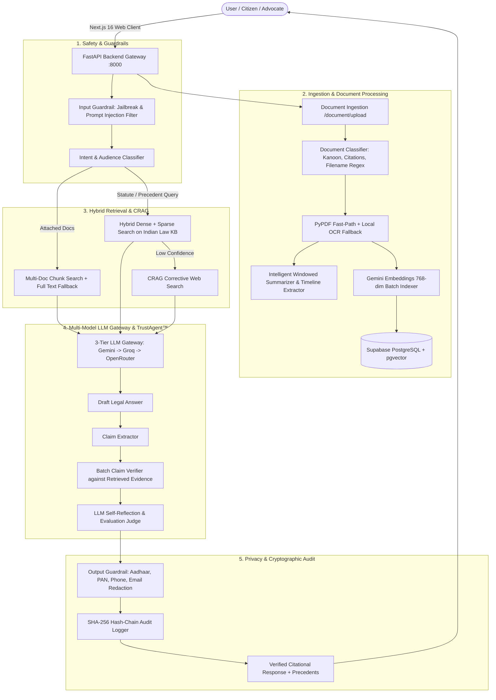

# ⚖️ NyayaPramaan (न्यायप्रमाण)
### *Enterprise Verifiable, Citational, & Transparent AI Platform for Indian Law*

[](https://nextjs.org/)
[](https://fastapi.tiangolo.com/)
[](https://supabase.com/)
[](https://python.org)
[](https://www.typescriptlang.org/)
[](https://opensource.org/licenses/MIT)

---

## 📌 Overview

**NyayaPramaan** is a production-ready, verifiable legal AI platform built specifically for the Indian legal ecosystem. It covers the **Constitution of India**, **Indian Penal Code (IPC)**, **Bharatiya Nyaya Sanhita (BNS)**, **Code of Criminal Procedure (CrPC)**, **Bharatiya Nagarik Suraksha Sanhita (BNSS)**, **Code of Civil Procedure (CPC)**, **Bharatiya Sakshya Adhiniyam (BSA)**, and landmark judgments of the **Supreme Court of India** and **High Courts**.

The platform prevents legal hallucinations by integrating **Multi-Document RAG**, **TrustAgent™ claim-level verification**, **Cryptographic Hash-Chained Audit Logs**, **Automated Indian PII Redaction**, **3-Tier Multi-Model Fallbacks**, and an **Interactive 3D Lady Advocate Guide** (*Advocate Nyaya Mitra*).

---

## 🏛️ System Architecture



---

## ✨ Key Platform Modules & Capabilities

### 1. 👩‍⚖️ Interactive 3D Lady Advocate Guide (*Advocate Nyaya Mitra*)
- **3D Perspective Entrance**: When opening the platform, a 3D-modeled Indian female advocate in formal legal attire appears with smooth perspective transitions.
- **Real-Time Voice Narration**: Built-in Web Speech API voice narration explains platform features with real-time audio wave animation and step-by-step guidance.
- **Guided Platform Tour**: Walks users through AI research chat, document uploads, precedent research, and developer extension procedures.

### 2. 📂 Multi-Document Analysis & Precedent Workspace
- **Instant Legal Classification**: Automatically recognizes Indian Kanoon case laws, Supreme Court & High Court judgments (e.g. *A.K. Gopalan vs State of Madras*), FIRs, bail petitions, affidavits, civil suits, deeds, contracts, and bare acts.
- **Intelligent Background Ingestion**: Processes multi-page files asynchronously with local PyPDF fast extraction, local Tesseract OCR, and multimodal Gemini fallback.
- **Large Document Safe Windowing**: Automatically windows massive judgments (100+ pages) to preserve parties, facts, issues, and operative orders without token/rate limit overflow.
- **Executive Case Briefs & Timeline**: Generates structured advocate briefs (Material Facts, Core Issues, Applicable Statutes, Ratio Decidendi, Operative Order) and chronological event histories.

### 3. 🛡️ TrustAgent™ Citation & Claim Verification
- Deconstructs AI draft responses into distinct factual claims.
- Evaluates each claim directly against retrieved statutory provisions or court records in a single batched LLM call.
- Labels citations as `verified`, `partial`, `contradicted`, or `unverified`.

### 4. ⛓️ Tamper-Evident Hash-Chain Audit Logging
- Every query, response, model selection, and verification verdict is appended to a cryptographic SHA-256 hash-chain stored in the database.
- Enables tamper detection and administrative compliance auditing.

### 5. 🔒 Multi-Layer Safety & Indian PII Redaction
- **Input Guard**: Blocks jailbreaks, prompt injections, and out-of-domain queries.
- **Output Guard**: Automatically redacts sensitive Indian PII (**Aadhaar numbers**, **PAN cards**, **Phone numbers**, and **Email addresses**).

### 6. 🌐 3-Tier Multi-Model Resilience Chain
- Fallback chain: `Gemini 3.6 Flash` ➔ `Groq (Llama / GPT-OSS)` ➔ `OpenRouter (DeepSeek R1)`.
- Features automatic backoff and in-process SHA-256 response caching.

### 7. 🎮 Citizen & Student Tools
- **Rights-Rakshak Game**: Scenario-based interactive legal education with instant scoring.
- **Daily Constitutional Quiz**: Dynamic 5-question daily quiz with judicial explanations.
- **Live Legal News Wire**: 24-hour curated feed of Indian judicial announcements and gazette updates.

---

## 🛠️ Technology Stack

| Layer | Technologies |
| :--- | :--- |
| **Frontend** | Next.js 16 (App Router), React 19, TypeScript, Vanilla CSS + Tailwind CSS, Lucide Icons |
| **Backend** | Python 3.11+, FastAPI, Pydantic, Uvicorn, LiteLLM, Google GenAI SDK |
| **Database & Vectors** | Supabase PostgreSQL with `pgvector`, Row-Level Security (RLS), JWT Authentication |
| **Embeddings & LLMs** | Google `gemini-embedding-001` (768-dim), Gemini 3.6 Flash, Groq GPT-OSS, OpenRouter DeepSeek R1 |
| **Verification & Audit** | TrustAgent™ Batched Claim Verifier, SHA-256 Cryptographic Hash Chain |
| **Testing** | Pytest, FastAPI TestClient, TypeScript Type-Checking (`tsc`) |

---

## 🚀 Getting Started

### 1. Prerequisites
- **Node.js** >= 18.x
- **Python** >= 3.11
- **Supabase Account** with PostgreSQL + `pgvector`

---

### 2. Environment Configuration

#### Backend `.env` (Root Directory)
Create a `.env` file in the project root:
```env
GEMINI_API_KEY="your_gemini_api_key"
GROQ_API_KEY="your_groq_api_key"
OPENROUTER_API_KEY="your_openrouter_api_key"
SUPABASE_URL="https://your-project.supabase.co"
SUPABASE_ANON_KEY="your_supabase_anon_key"
SUPABASE_SERVICE_ROLE_KEY="your_supabase_service_role_key"
```

#### Frontend `frontend/.env.local`
Create a `frontend/.env.local` file:
```env
NEXT_PUBLIC_API_BASE_URL="http://127.0.0.1:8000"
NEXT_PUBLIC_SUPABASE_URL="https://your-project.supabase.co"
NEXT_PUBLIC_SUPABASE_ANON_KEY="your_supabase_anon_key"
```

---

### 3. Database Setup (Supabase)
Run the migration script [`supabase_schema_updates.sql`](../supabase_schema_updates.sql) in your Supabase SQL Editor to set up:
- `cases` and `document_chunks` tables
- `session_documents` and `chat_sessions`
- `query_log` cryptographic hash-chain table
- `match_document_chunks_multi` vector similarity search RPC

---

### 4. Running the Backend

```bash
# Activate Python virtual environment
.\backend\venv\Scripts\activate   # Windows
# source backend/venv/bin/activate # Linux/macOS

# Install dependencies (if not already installed)
pip install -r requirements.txt

# Start the FastAPI server
python -m uvicorn backend.main:app --reload --host 127.0.0.1 --port 8000
```
- API is accessible at: `http://127.0.0.1:8000`
- Interactive Swagger UI: `http://127.0.0.1:8000/docs`

---

### 5. Running the Frontend

```bash
cd frontend

# Install dependencies
npm install

# Start Next.js development server
npm run dev
```
- Web Application is accessible at: `http://localhost:3000`

---

## 🧪 Testing & Verification

Execute the complete automated test suite:

```bash
# Run backend pytest suite
$env:PYTHONPATH="."
python -m pytest tests -v
```

Expected output:
```
tests/test_api.py::test_health_endpoint PASSED                           [ 12%]
tests/test_api.py::test_input_guardrails_safety PASSED                   [ 25%]
tests/test_api.py::test_output_guardrails_pii_redaction PASSED           [ 37%]
tests/test_api.py::test_intent_classification PASSED                     [ 50%]
tests/test_api.py::test_hash_chain_integrity PASSED                      [ 62%]
tests/test_api.py::test_document_classifier PASSED                       [ 75%]
tests/test_api.py::test_trustagent_corrector_and_jurisdiction PASSED     [ 87%]
tests/test_api.py::test_rights_game_scenarios PASSED                     [100%]
======================== 8 passed in 41s (100% pass rate) ========================
```

---

## 📁 Repository Structure

```
Nyayapramaan/
├── docs/                       # Complete Documentation Folder (Walkthrough, Implementation Plan, README)
│   ├── implementation_plan.md
│   ├── walkthrough.md
│   └── README.md
├── ai_core/                    # AI Engine & Intelligence Core
│   ├── evaluation/             # LLM Judges, Quiz & Game Generators
│   ├── guardrails/             # Safety & PII (Aadhaar, PAN, Phone) filters
│   ├── rag/                    # Embeddings, chunkers, classifiers, vector store
│   ├── router/                 # Adaptive model routing & intent classifier
│   ├── timeline/               # Chronological case event extraction
│   ├── trustagent/             # Fact verification & claim extraction
│   └── llm_gateway.py          # 3-tier resilient LLM gateway
├── backend/                    # FastAPI Application Services
│   ├── auth/                   # Supabase JWT validation & RBAC
│   ├── db/                     # Supabase storage & database interfaces
│   ├── models/                 # Pydantic schemas
│   ├── routers/                # Chat, Document, Case, Search, Quiz, News, Admin
│   └── main.py                 # FastAPI application entrypoint
├── frontend/                   # Next.js 16 (App Router) Client
│   ├── app/                    # Pages: /public/chat, /app/dashboard, /game, /quiz, etc.
│   ├── components/             # UI components, 3D Lady Advocate Guide, Answer cards
│   ├── hooks/                  # useTheme, useAuth, useVoiceInput
│   ├── lib/                    # Supabase client & utilities
│   ├── public/images/          # 3D Avatar and static assets
│   └── services/               # API clients (chat, documents, cases, search, etc.)
├── tests/                      # Automated unit and integration test suite
├── trust_log/                  # Cryptographic SHA-256 hash-chain audit engine
├── supabase_schema_updates.sql # Supabase DB & pgvector migrations
├── requirements.txt            # Python dependencies
└── README.md                   # Full platform documentation
```

---

## 📜 License
This project is open-source under the [MIT License](./LICENSE). Built for legal transparency, access to justice, and verified AI in the Indian judicial ecosystem.
