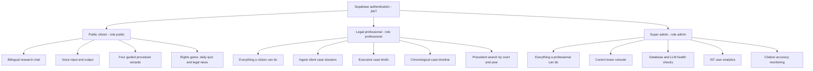
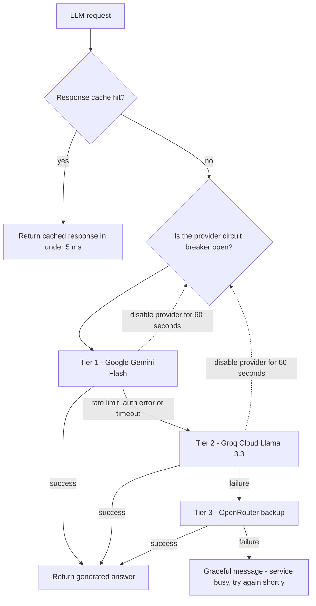
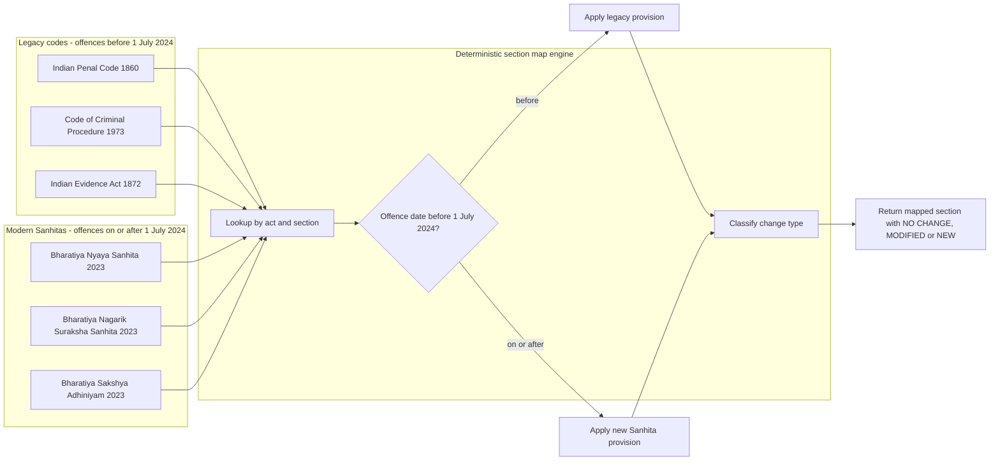
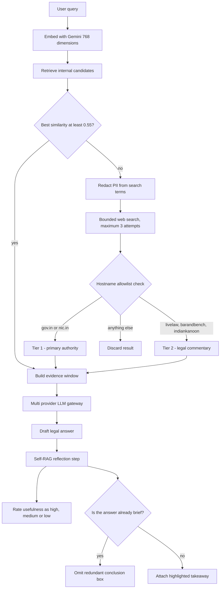

# Architecture Deep Dive — AI, RAG and Routing

Companion to the [main README](../README.md). This file covers how queries are routed, how the LLM gateway fails over, how old and new statutes are mapped, and how corrective retrieval works.

- [1. Role-based access control](#1-role-based-access-control)
- [2. Multi-tier LLM gateway and circuit breaker](#2-multi-tier-llm-gateway-and-circuit-breaker)
- [3. Section mapping engine](#3-section-mapping-engine)
- [4. Corrective RAG and Self-RAG](#4-corrective-rag-and-self-rag)

---

## 1. Role-Based Access Control

Enforced at the API layer (`backend/auth/supabase_auth.py`) and the UI layer (`frontend/components/auth/RoleGuard.tsx`). Each tier inherits everything from the tier below it.

A full feature matrix is in [README section 5](../README.md#5-user-roles-and-workspaces).

---

## 2. Multi-Tier LLM Gateway and Circuit Breaker

`ai_core/llm_gateway.py` wraps three providers behind one `litellm` interface, with an in-memory response cache in front and a circuit breaker per provider.

**Caching.** Prompt and model are hashed into a SHA-256 key. The cache is thread-safe and holds up to 256 responses, so repeated questions inside a session return almost instantly.

**Circuit breaker.** A provider that returns an auth error, HTTP 429 or timeout is disabled for 60 seconds (`BREAKER_SECS = 60`). Traffic moves straight to the next tier instead of paying the failure latency on every request.

---

## 3. Section Mapping Engine

`ai_core/rag/section_map.py` resolves provisions in both directions using a database table loaded from `data/section_map.csv` (1,316 verified transitions), and applies the 1 July 2024 cut-off rule.

**Worked example.** For *"What is Section 302 IPC?"* the engine returns the IPC provision with its applicability window, the BNS equivalent (**Section 103 BNS**), the change type, and the official India Code source link.

---

## 4. Corrective RAG and Self-RAG

When internal retrieval is weak, the system searches the open web — but only within a strict allowlist of official and reputable legal domains, and only after stripping PII from the query.

**Why the allowlist matters.** Legal misinformation is abundant on forums and content farms. Restricting corrective retrieval to government portals and established legal publications keeps the evidence window citable, and anything outside the allowlist is discarded rather than down-ranked.

**Self-RAG.** After drafting, the model critiques its own answer: it rates usefulness, extracts a one-sentence bottom line, and suppresses the takeaway box when the answer is already short enough that a summary would be redundant.

