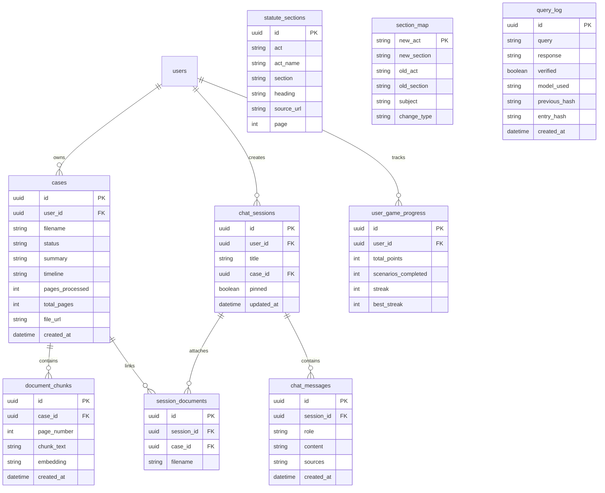
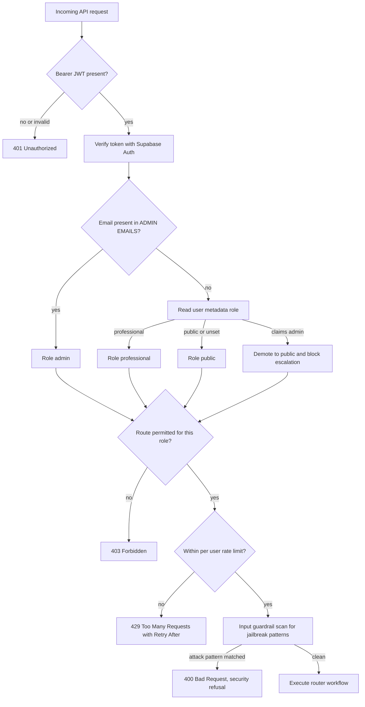
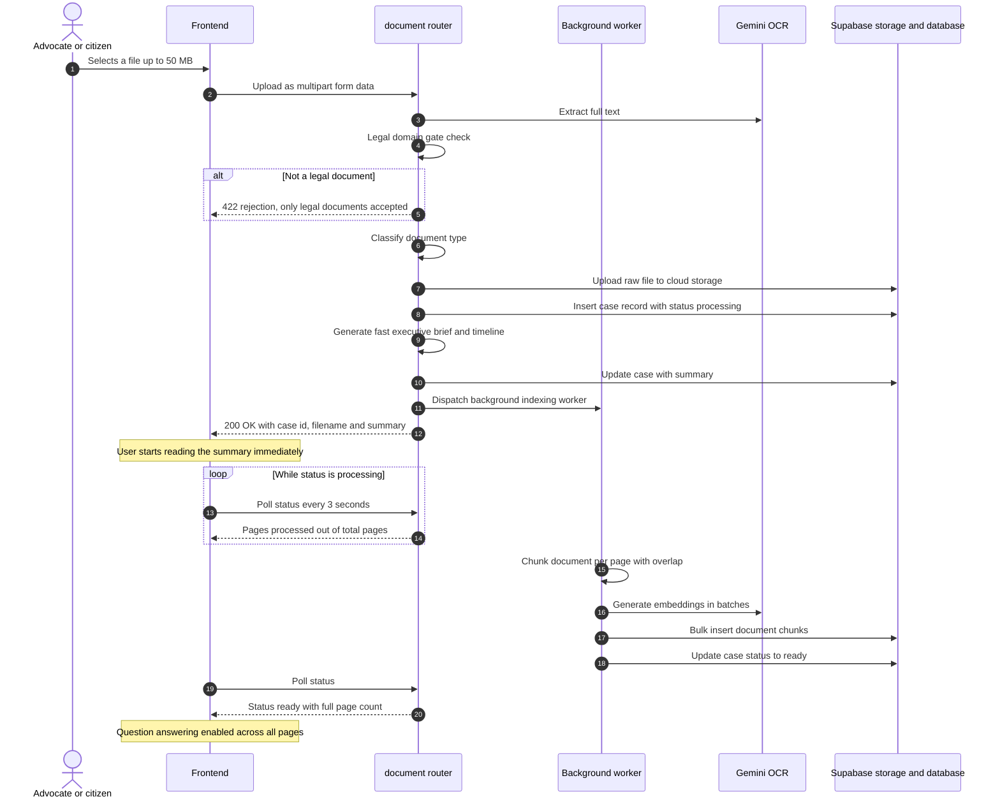
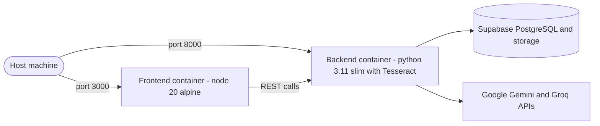

# Data and Security Deep Dive

Companion to the [main README](../README.md). This file covers the database schema, the request security flow, the document ingestion pipeline, and the container topology.

- [1. Database schema](#1-database-schema)
- [2. Authentication and security flow](#2-authentication-and-security-flow)
- [3. Document ingestion pipeline](#3-document-ingestion-pipeline)
- [4. Docker container topology](#4-docker-container-topology)

---

## 1. Database Schema

PostgreSQL 15+ on Supabase with the `pgvector` extension.



> **Note on types.** `document_chunks.embedding` is a native `vector(768)` column, `statute_sections` also stores the full provision text, and `section_map` uses a composite primary key of `new_act`, `new_section` and `old_section`. The diagram simplifies these because Mermaid's ER renderer models neither vector types nor composite keys.

### Hash-chained audit ledger

Each row in `query_log` stores `entry_hash = SHA-256(payload + previous_hash)`. Any retrospective edit to an earlier row breaks the chain for every row after it, which `trust_log/hash_chain.py` detects during validation.

### Search RPC functions

| Function | Purpose |
| :--- | :--- |
| `match_document_chunks` | Cosine similarity over one case's chunks |
| `match_document_chunks_multi` | Similarity across several dossiers at once |
| `hybrid_search_judgments` | Vector proximity blended with full-text ranking |
| `hybrid_search_statutes` | Full-text ranking with an exact section-number boost |

Definitions live in `backend/sql/hybrid_search_functions.sql`. After running them, execute `NOTIFY pgrst, 'reload schema';` so the REST API stops serving a stale schema cache.

---

## 2. Authentication and Security Flow



**Anti-escalation.** Role is never taken from client-controlled metadata alone. A user who sets `{"role": "admin"}` in their own Supabase metadata is demoted to `public` unless their email appears in the server-side `ADMIN_EMAILS` list.

**PII redaction.** `ai_core/guardrails/output_guard.py` masks Aadhaar numbers, PAN numbers, Indian phone numbers and email addresses before a response reaches the user or the audit ledger.

**Secrets.** All credentials come from environment variables. `.env` is gitignored, `.env.example` holds placeholders only, and any key exposed by accident should be rotated rather than merely removed from the history.

---

## 3. Document Ingestion Pipeline

The upload request never waits for indexing. It returns as soon as the summary is ready, and a background worker finishes chunking and embedding while the UI polls for progress.



**Why page numbers are preserved.** Chunking keeps the source page with every chunk, so a cited passage can be traced back to an exact page in the original filing — which is what makes the TrustAgent citation check meaningful rather than decorative.

**Recovery.** If a run is interrupted, the retry-indexing endpoint re-chunks from the stored text without a re-upload.

---

## 4. Docker Container Topology



Both containers read the root `.env`. The backend image bundles Tesseract and Poppler so OCR works without external calls when a document cannot be parsed digitally.

```bash
docker compose up --build     # build and start
docker compose up -d          # detached
docker compose down           # stop everything
```

